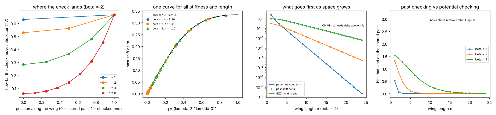
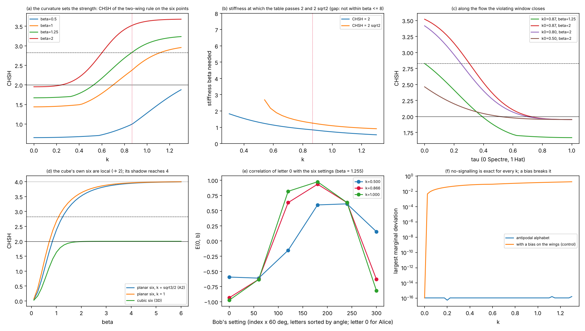

# Past checking and potential checking

Status: working note. Labels as in `QUANTUM_GRAVITY.md`: **Exact** means checked by a test in this repository, **Definition** is a choice made in the toy, **Hypothesis** is a reading that nothing here tests, and **Not explained** is something the toy needs but does not provide. Nothing here is gravity, and nothing here is three-dimensional space. "Space" below means the number of steps of a history between two places in it.

Code: `research/toymodel_v2/tm2_checking.py` (6 tests). It builds on `tm2_rule.py` (Stage 4, `research/toymodel_v2/STAGE4.md`). Figure: `research/toymodel_v2/figures/tm2_checking.png`.



## 1. The idea, and the question it becomes

Your words:

> The Past is still right here next to you and far away is the future: past vs potential, greater space as greater potential checking, less space as more past checking.

In the toy, a history has a shared past and two ends that are checked. How much of the check reaches back to the past, and how much stays at the ends, depending on how much history lies in between?

That question has an exact answer in one small model. This note works it out.

## 2. The model (all Definition)

```
      Alice's end   s_A(n) = ±a         (checked)
           |
     n steps, weight exp(−β N(step)) each
           |
        origin   v   ← the shared past (one of six hexagonal directions)
           |
     n steps, starting at −v
           |
       Bob's end   s_B(n) = ±b          (checked)
```

- **Letters.** Each letter is one of the six red A2 roots of the Spectre lift. N is the planar norm² of a step: 0, 1, 3 or 4 for letters 0°, 60°, 120° or 180° apart. The weight is the first term of the paper's action.
- **Stiffness.** β is the stiffness: large β makes each wing nearly straight.
- **The check.** Each end must land on its setting's axis, at +a or −a. The table is normalised over the histories that pass both checks (Stage 4, D4.3). That conditioning is the assumption everything here rests on.
- **Space and the past.** The past is the origin v, and the space is the wing length n.

## 3. What the check can say about the past (Exact)

### 3.1 Only the axis gets back

Summed over the outcome, the weight that an end sends back to the origin is

    g(v, a) = (λ₀ⁿ + 2 λ₂ⁿ cos(2π(v − a)/3)) / 3

Here λ₀, λ₁, λ₂ are eigenvalues of the 6 × 6 step matrix (`tm2_rule.eigen`). Mode k = 1 is odd under v → −v, so it carries a sign. Mode k = 2 is even, so it carries an axis only.

The odd modes cancel when the outcome is summed. **The past learns which axis was checked, not what was found there:** a and a + 180° give the same distribution of the origin (test E6.1).

### 3.2 One formula for the past shift

The largest shift of the origin's distribution, the paper's δ, is reached when both ends are checked along the same axis:

    δ = q(2 + q) / (3(1 + 2q²)),    q = (λ₂ / λ₀)ⁿ

This holds for every stiffness and every length. δ depends on β and n only through q, and for long wings it tends to 2q/3 (E6.2; second panel of the figure, where three stiffnesses and twenty lengths fall on one curve).

| β = 2 | n = 1 | 2 | 4 | 8 | 16 |
|---|---|---|---|---|---|
| past shift δ | 0.315 | 0.264 | 0.141 | 0.030 | 0.0013 |
| bits that land on the past | 1.322 | 0.865 | 0.240 | 0.011 | 0.000 |
| bits the check removes in all | 2.233 | 2.666 | 3.049 | 3.164 | 3.170 |

The last row is for the same axis at both ends. Averaged over the nine axis pairs it is at least log₂ 9 = 3.17 bits and tends to it (E6.5).

So the check always costs about the same, about 3 bits: the two ends land on their axes. What changes with space is where those bits sit:
- with one step of space, 1.3 of them are information about the shared past;
- with eight steps, 0.01 are;
- the rest constrain only the ends.

### 3.3 Where along the history the check lands

The table below, the first panel of the figure, gives how far the check moves the letter at each node between the shared past (0) and the checked end (1), for β = 2:

| n | origin | … | end |
|---|---|---|---|
| 1 | 0.630 | | 0.667 |
| 2 | 0.528 | 0.561 | 0.667 |
| 4 | 0.283 | 0.303, 0.365, 0.481 | 0.667 |
| 8 | 0.059 | 0.064 … 0.452 | 0.667 |

- **The end is always fully checked.** 2/3 is the value for a letter forced onto two of six (E6.4).
- **Short space.** The check fills the whole history, past included.
- **Long space.** It is concentrated near the ends and the past is left almost as it was.

That is the exact version of "less space, more past checking; more space, more potential checking", with "potential" read as the histories that are not pinned down.

## 4. Three things fade, at three rates (Exact)

As space grows, three quantities fall off exponentially, each governed by a different eigenvalue (E6.3; third panel):

| quantity | what it is | decays as | rate per step at β = 2 |
|---|---|---|---|
| pass-rate contrast | how much the chance that a history passes depends on the far setting | (λ₂/λ₀)^(2n): the axis must reach the origin and come back | 0.783 |
| past shift δ | how far the check moves the shared past | (λ₂/λ₀)^n: one wing | 0.392 |
| end-to-end correlation \|E\| | how the two outcomes agree | (λ₁/λ₀)^(2n): the sign, through the origin | 0.239 |

The order, contrast first, then the past, then the correlation, holds at every stiffness tested (β from 0.05 to 8), because λ₁² > λ₀λ₂.

**A correction to how I put it earlier.** I wrote that with long wings "the correlation between the ends vanishes with" the past shift. It vanishes more slowly. What vanishes with the past shift is the *violation*. On the grid of Stage 4, a CHSH value above 2 never occurs once δ is below 0.14. For example, at β = 3 and n = 16 the past is shifted by only 0.066, the ends are still correlated (|E| = 0.442 at zero angle), and CHSH is 1.117 (E6.6).

So there are two regimes:

- **Short space (past checking).** The check reaches the shared past and revises it. Correlation is strong, and above the threshold it is stronger than any fixed shared past allows (CHSH > 2). The pass rate also depends on both settings.
- **Long space (potential checking).** The check stays at the ends. The past is left as it was, the pass rate no longer depends on the far setting, and the ends are still correlated, but only as much as a fixed shared past allows.

Between them, β sets the scale. The past shift has a length of 1/0.392 = 2.6 steps at β = 2 and 6.8 steps at β = 3. Stiffer histories carry the check further back.

## 5. What this does to the idea of "checking as a process"

The earlier note (`SPECTRE_HAT_FLOW.md`, "A reading of the flow") raised a constraint. If a check takes time in proportion to how rarely it passes, that time depends on both settings, and a locally visible duration would signal. Section 4 sharpens this:

- **The constraint only bites in short space.** The pass-rate dependence is the first thing to fade: 8·10⁻⁹ of its n = 1 size by n = 24 at β = 2.
- **In short space it does not fade.** That is exactly where the past is revised and CHSH can exceed 2. So the regime where "checking the past" does something non-classical is the regime where the duration of a check would carry information about the far setting.
- **Any reading of this toy has to say what happens there.** Either the duration of a check is not observable at one end alone, or the short-space regime signals. This is a statement about the toy, not a refutation of the idea.

## 6. Your picture, claim by claim

| your statement | in the toy | status |
|---|---|---|
| The past is still right here | the shared origin is part of every history, and the check acts on it through the even mode | **Exact** for the toy |
| less space, more past checking | short wings: δ = 0.315 and 1.3 bits on the past at n = 1, β = 2 | **Exact** |
| greater space, greater potential checking | long wings: the same ~3 bits removed, almost all at the ends; the past is unrevised | **Exact** |
| far away is the future | the ends are where the check is decided and the outcome's sign lives. Calling the end "future" and the origin "past" is a naming | **Hypothesis** |
| checking is part of the forward flow | the check is a conditioning on the ends of a history, not a process in time; durations are not modelled | **Not explained** |
| space as distance | n counts letters of a history. The link to distance needs the map of Stage 5, which is not derived | **Not explained** |

One reading this suggests, and nothing tests: matter, which is stiff (large β), would carry the check further into its past than light, soft histories do. Under this reading, "the past next to you" would be the stretch of history within about 1/ln(λ₀/λ₂) steps of each check. **Hypothesis.**

## 7. The letters taken from the tile (added 2026-11-12)

Sections 2 to 5 use six hexagonal letters that were chosen. `research/toymodel_v5/t5_rule.py` takes them from the tile instead: the six points that the bit of the 14th vertex moves, `(0, ±1)` and `(±k, ±1/2)` about P₈, with step cost `exp(−β |V_i − V_j|²)`. The wings, the hard pins and the normalisation are those of section 2. At `k = √3/2` the six points are the regular hexagon and every table of this note is reproduced to 10⁻¹².



**What the figure shows.**

- *(a)* CHSH against the curvature `k` at four stiffnesses. At β = 1.255: 1.670 (k = 0), 1.943 (1/2), 2.828 (√3/2), 3.057 (1). The dotted red line is the hexagon.
- *(b)* The stiffness at which the table passes 2 and 2√2. A flatter alphabet needs a stiffer history: 1.308 at k = 1/2 against 0.841 at the hexagon.
- *(c)* The same value along the flow, `k = k₀(1 − τ)`. From the hexagon it falls below 2 at τ = 0.391 (β = 1.255) or 0.718 (β = 2), and ends just under 2 at the Hat.
- *(d)* The control. The cube's own six directions never exceed 2 (1.992 at β = 2); their planar shadow reaches 3.9993.
- *(e)* The correlation of one letter with the six settings for three curvatures.
- *(f)* No-signalling holds to 10⁻¹⁶ for every `k`, because the set is antipodal; a bias on the wings breaks it.

**How it fits this note.**

1. Section 4 found three things that fade with the length of the wings, at three rates. Panel (c) is a fourth way to fade, and it is along the flow instead of along space: the check on the shared past loses its grip as the tile flattens, at a fixed wing length. In the words of section 1, "past checking" needs curvature as well as closeness.
2. The stiffness β was the one free number of section 2. With letters from the tile, part of it is geometry: the squared step distances contain `k`. This does not fix β; it says that β and `k` cannot be chosen independently if the letters are the tile's.
3. At the Hat two letters coincide and the table is still defined, with CHSH between 1.67 and 1.95. The Hat is a loss of range, not a change of sign. That matches section 3: the check then says only what a shared-past model could say.
4. Panel (d) answers a question this note left to a choice (hexagonal or cubic letters). In this rule the cubic six cannot beat 2 at any stiffness; the hexagon is their image seen along a body diagonal of the cube (`t5_alphabet.py`), and it can. The weight is still a Definition, so this is a property of the rule, not a reason for nature to use it.

Caution, as before: the family passes through 2√2 and goes above it. There is no quantum bound here.

## 8. What would test it next

1. Put the flux term λ of the paper's action back on the wings. It ties the wings together through the total flux and may change which mode reaches the past.
2. Let the check be soft (boundary weight μ instead of a pin) and see whether the order of the three rates survives. `tm2_rule.TwoWing` already supports μ.
3. Give each wing its own length (n_A ≠ n_B) and ask which end the past "listens to".
4. Replace the straight wing by a walk on the Spectre tiling (Stage 6), so that "space" is a number of tiles, not of letters.

## 9. Reproduce

```
python3 research/toymodel_v2/tm2_checking.py --tests-only       # 6 tests, under a second
python3 research/toymodel_v2/tm2_checking.py --story            # the tables above
python3 research/toymodel_v2/tm2_checking.py --no-show --save research/toymodel_v2/figures/tm2_checking.png
python3 research/toymodel_v5/t5_rule.py --tests-only            # 5 tests (section 7)
```

Related notes: `ARROW_OF_TIME.md` (section 7), `SPECTRE_HAT_FLOW.md` ("A reading of the flow"), `research/toymodel_v2/STAGE4.md`.
