# Quantum gravity thread: connections, results and sources

The running record of the models that look for connections between the Spectre tile, the Chair44, tight-binding lattices
(your `quantum-lattice` fork) and the Hopf-fibration / E8 literature. Figures are in `figures/`; the code is in `models/`
(plan and status: `models/README.md`).

Labels used throughout: **Exact** (an identity or count checked by a test), **Numeric** (computed on a finite patch or
grid), **Hypothesis** (an idea with no test yet). For sources: **Fetched** (page opened for this file), **Notes** (your text,
kept as given, not verified), **Not opened**.

## Results so far

### Tight-binding on the Spectre family (`models/_tb.py`)

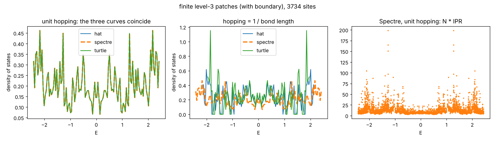

*Reproduce: `python3 models/_tb.py --no-show --save-dir figures`.* Finite level-3 patches (3734 sites, with boundary).

- **Exact:** V, E, F = 3734, 4292, 559 and V - E + F = 1; Hat (1, sqrt3), Spectre (1, 1) and Turtle (sqrt3, 1) have the same
  bond graph, so with unit hopping their spectra are identical (left panel: one curve); the spectrum is symmetric about 0
  (bipartite); sum E^2 = sum H_ij^2.
- **Numeric:** unit hopping E in [-2.434, 2.434], mean N * IPR 14.7. With hopping 1/length the three tilings differ (middle
  panel): Hat E in [-2.133, 2.133], mean N * IPR 84.4; Turtle [-1.965, 1.965], 58.7. These agree with the numbers in your
  `quantum-lattice` `TILINGS.md` (unit hopping exactly; 1/length N * IPR within about 2 of its 82.4 and 57.7, cause not
  shown). Three finite patches give no scaling law.

### Fibres from the tile to the Chair44 pyramid tips (`models/chair_fibers.py`)

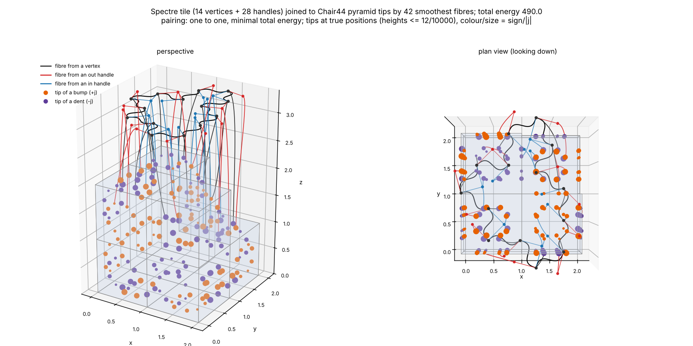

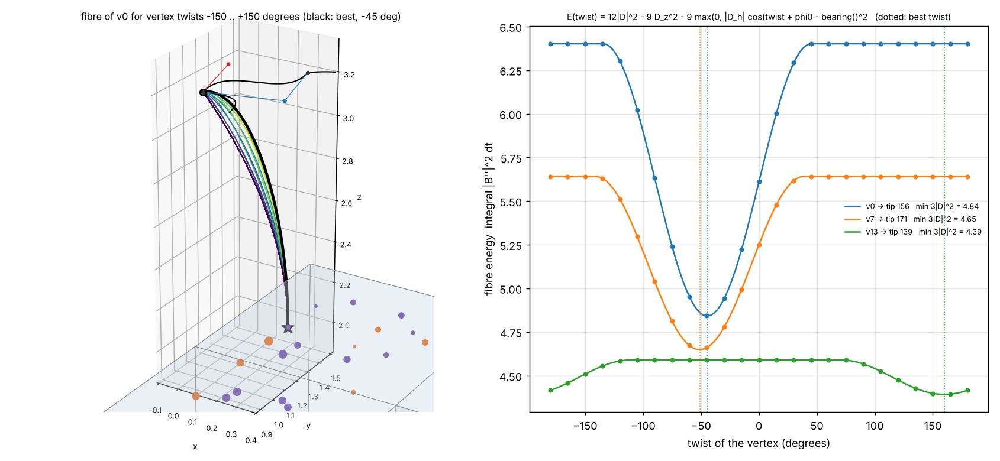

*Reproduce: `python3 models/chair_fibers.py --no-show --save-dir figures`.*

- **Exact (SymPy):** the fibre energy E = integral of |B''|^2 is a convex quadratic in the two end speeds; for a tip on an
  up-facing panel E(phi) = 12 dd - 9 beta^2 - 9 max(0, alpha)^2 and E_min = 3 |D|^2, so a vertex twist moves the best
  fibre exactly as the law says, with a plateau where the vertex points away from its tip.
- **Numeric / a rule, not a fact:** the one-to-one pairing of the 42 bases (14 vertices, 28 handles) with tips is the minimum
  total energy over the placement chosen (total 490.0 for a = b = 1, k = 0.5). It does not test the thesis of the top-level
  README.

### Hopping that follows a twisted edge (`models/twist_hopping.py`)

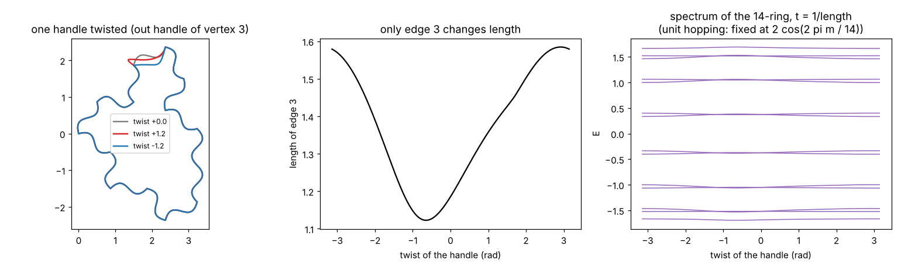

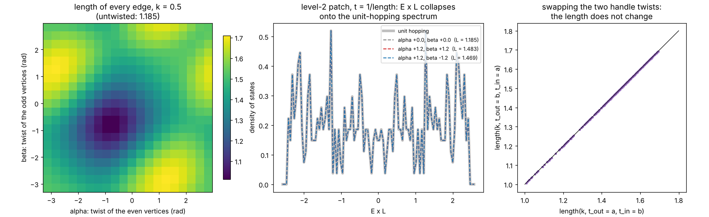

*Reproduce: `python3 models/twist_hopping.py --no-show --save-dir figures`.* The idea: with hopping `t = 1/length` on curved
edges, twisting the handles changes the spectrum. What came out:

- **Exact:** the twists that make copies of one tile fit together are two numbers, alpha and beta, the twists of the even
  and odd vertices (tested on the real patches of levels 1 to 3). Reversing an edge shows that its length is unchanged when
  its two handle twists are swapped, so every edge has the same length `L(alpha, beta)` and the spectrum is the
  unit-hopping spectrum divided by `L` (left panel: `L`; middle panel: the three twisted spectra, multiplied by `L`, lie on
  the unit one). So twisting a tiling in the only way it can be twisted only rescales it; with `L >= 1` the largest
  eigenvalue can only go down from 2.4288 (level 2).
- **Numeric:** `L` runs from 1.012 to 1.709 for `k = 0.5` (1.185 untwisted).
- **One tile alone** (top figure) does change shape: a twisted handle changes one edge length and splits the 14-ring's
  eigenvalues slightly; for unit hopping they stay at `2 cos(2 pi m / 14)`. This is a statement about a tile that does not
  tile the plane.
- **Hypothesis for next:** a hopping rule that depends on the corner turn, or on non-glued twists, is where shape could
  change; not built.

### 24-cells and Hopf fibres of the 600-cell and of E8 (`models/hopf_shells.py`)

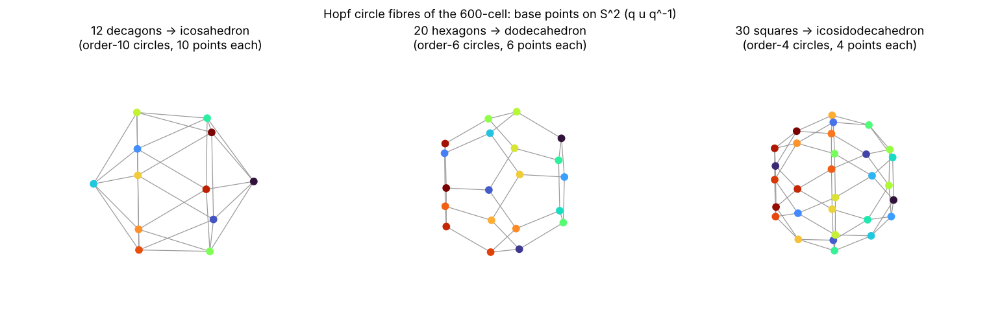

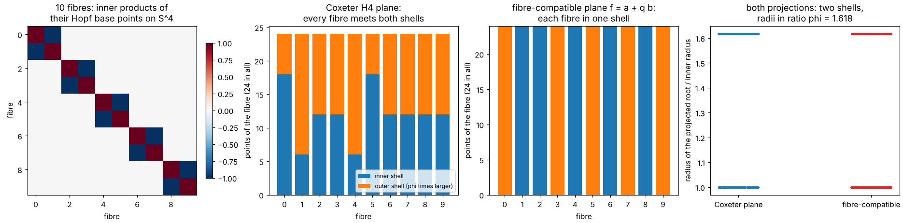

*Reproduce: `python3 models/hopf_shells.py --no-show --save-dir figures`.* Objects: 2I (the 120 unit icosians = the
600-cell), 2T (24 Hurwitz units = a 24-cell), and the 240 roots of E8 as pairs `(a, b)` of Hurwitz quaternions with
`a - b` in `(1 + i)H`. A *fibre* of the roots is an orbit of `(a, b) -> (a l, b l)`, `l` in 2T.

- **Exact:** 2I is 5 disjoint 24-cells (left cosets of 2T), and 5 others (right cosets); 2T is not normal, so they differ.
- **Exact:** the Hopf circle fibrations of the 600-cell: 12 decagons over an icosahedron, 20 hexagons over a dodecahedron,
  30 squares over an icosidodecahedron (base points compared by their inner-product multisets; top figure).
- **Exact:** the 240 E8 roots form a root system (norm 2, closed under reflections) and split into **10 fibres of 24**,
  each a 24-cell. The quaternionic Hopf map `S^7 -> S^4` is constant on a fibre, and the 10 base points are five orthogonal
  axes and their negatives: the vertices of the 5-dimensional cross-polytope (left panel, bottom figure).
- **Exact, one construction:** the orthogonal projection of E8 onto the H4 plane of its Coxeter element (angles
  2 pi {1, 11, 19, 29} / 30) gives two shells of 120 points, radii in ratio phi, with the 600-cell's inner products. But
  these shells do **not** follow the fibres: every fibre has points in both (second panel).
- **Exact:** a projection that does respect the fibres exists: `f(a, b) = a + q b` with `q` = phi or 1/phi times one of the
  16 units `(+-1 +- i +- j +- k)/2` (32 choices, found by a search over the unit icosians times powers of phi). It is right-linear,
  so a fibre goes to a scaled 24-cell, and it is an orthogonal projection up to scale. The roots land on two shells of 120
  (radii in ratio phi), each a rotated copy of 2I and each **a union of 5 whole fibres** (third panel). So 240 = 10 x 24 splits as
  5 + 5 fibres over twin 600-cells.
- **Exact (new, checked against Quantum_Gravity_Lab):** 2I contains exactly **25** inscribed 24-cells of the form `g 2T h`, and
  exactly **10** ways to split it into five of them. These 10 are the left and the right coset partitions of the **5 conjugates of 2T**
  in 2I (5 + 5), so the "5 + 5 by chirality" seen numerically in QGL (`qgl_cqc.py`, `tests/test_cqc.py`) is the left/right split,
  and 25 = 5 x 5. Found independently here by quaternion algebra (`inscribed_24cells`, `coset_partitions`); QGL found them as
  24-cliques of a Gram graph. The two agree.
- **What this says about the notes in section 1:** the counts they quote (24-point fibres, 10 of them, twin 600-cells) are
  reproduced for this Hurwitz construction, and the fibre-by-fibre structure is real. The icosian construction (next section)
  turned out to be the same fibred root system in other coordinates. Nothing here selects sites, and nothing links to the
  Spectre or the Chair44. The coincidence `192 = 8 x 24`
  (section 3, item 2) is still only a coincidence.

### E8 from the icosians, and the comparison (`models/icosian_e8.py`)

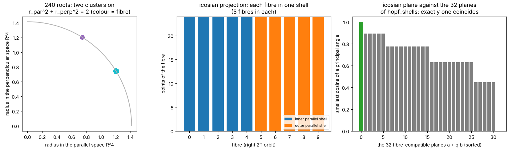

*Reproduce: `python3 models/icosian_e8.py --no-show --save-dir figures`.* This builds E8 the way Elser and Sloane (and Sadoc
and Mosseri's Z[phi]-structure) describe it: the icosian ring mapped by `x -> (x, x^sigma)`, `sigma: phi -> -1/phi`, and asks
whether it differs from the Hurwitz construction of `hopf_shells.py`.

- **Exact (derived here, tested):** with the form `(3 - phi)|x|^2 + (2 + phi)|x^sigma|^2` the 120 unit icosians `u` and the 120
  vectors `phi u` have the same norm, and `Phi(x) = sqrt(2/5) (sqrt(3 - phi) x, sqrt(2 + phi) x^sigma)` over them is an E8 root
  system (norm 2, integral, reflection-closed, Cartan determinant 1). The tempting alternative `phi w^sigma` is not (negative
  control).
- **Exact:** the Hurwitz units are fixed by `sigma`, so right multiplication by 2T acts the same way on both factors: the 2T
  orbits are Hopf fibres, again 10 of 24, each a 24-cell, with the 5-cross-polytope as base points.
- **Exact:** projecting to the first factor ("parallel space") gives two shells of 120 (radii in ratio phi, each a rotated
  copy of 2I), and **each shell is 5 whole fibres** (middle panel). The second factor ("perpendicular space") gives two shells
  with the roles swapped (copies of the conjugate group, checked by inner products only). Parallel and perpendicular radii
  lie on `r_par^2 + r_perp^2 = 2` in two clusters (left panel).
- **Exact:** there is an isometry of R^8 that maps the Hurwitz roots onto the icosian roots and every Hurwitz fibre onto an
  icosian fibre (found by backtracking, then checked on all 240 roots). Under it the icosian parallel plane is exactly one of the
  32 fibre-compatible planes `a + q b` of `hopf_shells.py` (`|q| = 1/phi`), and the perpendicular plane is exactly one other
  (`|q| = phi`); no other of the 32 coincides (right panel). Both planes are invariant under right multiplication by 2T.
- **So:** for E8 the icosian projection and the Hurwitz fibre-respecting projection do not differ. They are one fibred root
  system seen in two sets of coordinates; the "Hopf grouping into 24-point fibres" and the icosian "parallel/perpendicular"
  split are compatible, with whole fibres on one side of the shell structure.
- **Not shown:** the papers' selection of whole fibres shell by shell (the quasicrystal itself), the arithmetic shell-count
  formula, and the 2D-1D reduction. Those need the shells of E8 beyond the roots, not built.

### Shells of E8 beyond the roots (`models/e8_shells.py`)

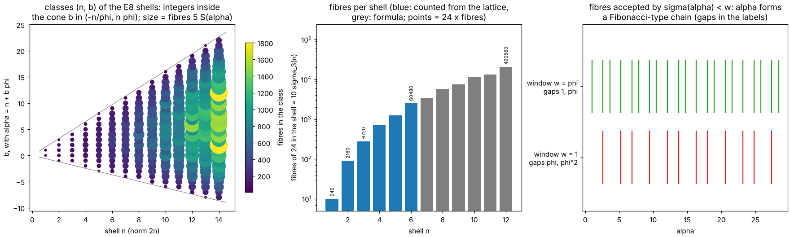

*Reproduce: `python3 models/e8_shells.py --no-show --save-dir figures`* (tests about 6 s). Tests each sentence of the
Sadoc-Mosseri abstract (section 1) on the Hurwitz / icosian construction, going up to shell 6 (60480 vectors).

- **Exact (counted, shells 1 to 6):** shell `n` has `240 sigma_3(n)` vectors (240, 2160, 6720, 17520, 30240, 60480) and splits into exactly
  `10 sigma_3(n)` fibres of 24 (checked by orbit counting for n <= 4; no vector is fixed by a non-trivial unit).
- **Exact (2D lattice):** in the icosian coordinates a vector has reduced norm `alpha = n + b phi` (integers `n`, `b`; both checked from
  the coordinates, residual 1e-14): the shell index is the integer part, and `b` runs over the integers in `(-n/phi, n phi)`, about
  `sqrt5 n` values (left panel). The position inside a shell is one integer in a window: this is the "2D-1D" structure.
- **Arithmetic formula (exact on shells 1 to 6, as an identity of integers for n = 1 to 60):** the number of vectors in the class
  `(n, b)` is `120 S(alpha)`, with `S(alpha)` the sum of the norms of the ideals of Z[phi] dividing `(alpha)`; the classes of a shell
  add up to `240 sigma_3(n)`. Each class is `5 S(alpha)` fibres. This is the shell-by-shell count of the paper's abstract in the
  form that this construction gives; I derived `S` from the structure of the icosian ring (a maximal order of class number one,
  ramified at the infinite places only) and checked it, I did not prove it, and I did not compare it with the paper's formula, which I have
  not read.
- **Whole fibres selected or rejected (exact, with a condition):** both radii `(|a|, |b|)` are constant on a fibre, so any rule
  depending on the radii (a ball `sigma(alpha) < w` in the perpendicular space) accepts or rejects a whole fibre (checked
  on all fibres of shells 1 to 4). A rule on one coordinate does not (negative control: it splits every fibre). Elser and
  Sloane's window is a polytope, not a ball; whether *their* window respects fibres is not tested.
- **Fibonacci chain (exact on the range):** accepting `alpha` with `0 <= sigma(alpha) < w` gives a model set whose gaps are
  `{1, phi}` for `w = phi` and `{phi, phi^2}` for `w = 1` (right panel). This is a general property of Z[phi] windows
  and not special to E8; what is specific to E8 is that the window acts on whole fibres.

### Which windows keep fibres whole (`models/fibre_window.py`)

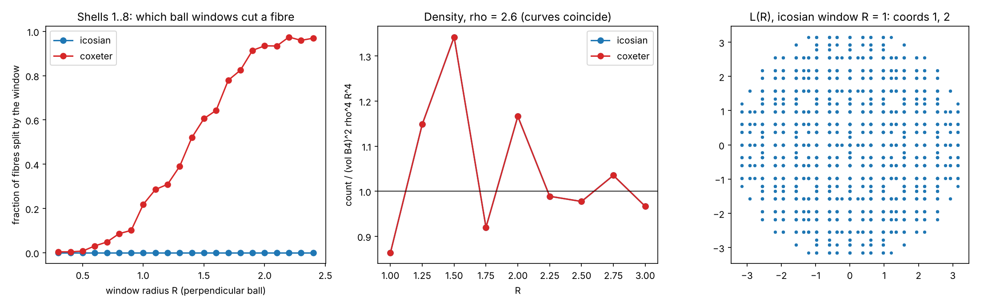

*Reproduce: `python3 models/fibre_window.py --no-show --save-dir figures`.* Cut-and-project sets `L(R)` from E8 (shells 1..8,
340 320 vectors, 14 180 fibres) with a ball of radius `R` in the perpendicular space, for two splittings of R^8 into 4D + 4D:
the icosian one (`icosian_e8.py`) and the Coxeter-plane one used in Quantum_Gravity_Lab.
- **Exact:** the icosian ball window never splits a fibre (R from 0.5 to 2.0 tested); the Coxeter ball window splits many
  (about 1 in 3 fibres at R = 1.4, nearly all by R = 2). Left panel. So the fibre-by-fibre selection of the papers is realised by the
  icosian splitting and not by QGL's, for a ball window.
- **Caveat, stated plainly:** the cause is only that the icosian perpendicular radius is a function of `(|a|, |b|)`, which is constant on a fibre.
  Any window depending on those two radii alone also keeps fibres whole, so this does not single out the icosian splitting as special beyond
  that; it shows the property is easy to have and easy to lose.
- **Exact (checked numerically on 340 320 vectors):** the two splittings give the same joint distribution of `(|par|^2, |perp|^2)`, so any radial window
  has the same number of points in either. They differ only in which vectors are chosen. The parallel images are all distinct.
- **Numeric:** the number of points with `|par| <= rho`, `|perp| <= R` matches `vol(B4)^2 rho^4 R^4` (E8 covolume 1) to 3.5 per cent over four
  boxes with `rho, R` between 1.5 and 3.4; small boxes are off by up to 15 per cent (discreteness). Middle panel; the two curves coincide.
- **Not done here:** the polytope window; see the next section. Nothing here touches the Spectre or the Chair44.

### The Voronoi-cell window (`models/voronoi_window.py`)

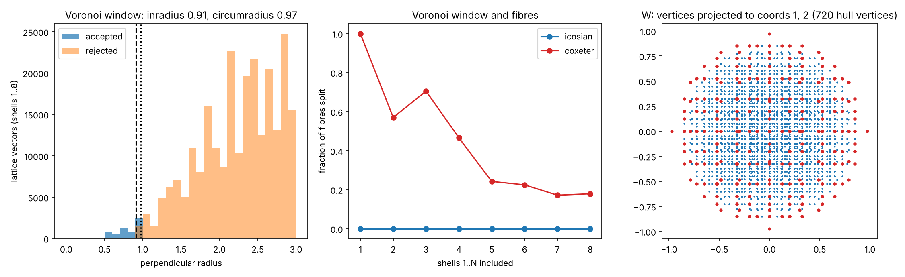

*Reproduce: `python3 models/voronoi_window.py --no-show --save-dir figures`.* The window is `W = proj_perp(Vor(E8))`, the 4D shadow of the
Voronoi cell of E8, and the point set keeps the lattice vectors whose perpendicular part is in `W` (equivalently: the vectors whose Voronoi
cell the physical space cuts). **Hypothesis:** this is the window of Elser and Sloane. I read it that way from the notes in section 1 and did not
have their paper, so only the properties below are claimed, not the attribution.
- **Exact:** the Voronoi cell of E8 has 19440 vertices (2160 at norm^2 1, 17280 at norm^2 8/9; generated from the alcove vertices by the
  Weyl group, each tight on 8 to 14 roots) and 240 facets.
- **Exact (icosian splitting):** `W` is a 4D polytope with 720 vertices and 2640 facets, volume 3.530, and it is **nearly a ball**: inradius
  0.9092, circumradius 0.9732. Lattice vectors below the inradius are always accepted, above the circumradius never.
- **Exact:** the window is invariant under the 24 rotations that move along a fibre, and **no fibre of shells 1..8 is split** (6120 of 340 320
  vectors accepted, 14 180 fibres). The reason is a group fact: `(a, b) -> (a l, b l)` is a lattice automorphism that commutes with the
  icosian splitting, so it preserves the Voronoi cell and its shadow. This replaces the weaker radii-only reason given for balls above: it
  holds for any window invariant under that group.
- **Negative control:** the same construction with the Coxeter splitting of Quantum_Gravity_Lab splits 2540 of 14 180 fibres (fraction falling
  from 1 at shell 1 to about 0.18 by shell 8, middle panel), and a window shifted by 0.15 splits 140 fibres of shells 1..6 (checked by hand, not a test).
- **Numeric:** accepted points with `|par| <= rho` match `vol(W) vol(B4) rho^4` to 1.2 per cent at `rho` = 3.6 and 3.8. At small `rho` the
  count jumps in steps (the parallel radii take discrete values), so the match there is poor.
- **What this changes:** for the papers' fibre-by-fibre selection, the question is not the shape of the window but whether it is invariant
  under the fibre group, which the Voronoi shadow is. Since `W` is within 7 per cent of a ball in radius, the earlier ball-window point sets
  are a good approximation to this one.
- **Still open:** the exact Elser-Sloane paper's window and normalisation (to confirm the hypothesis); a figure of the 4D point set itself
  (the third panel only shows the window's vertices in two coordinates); the Spectre / Chair44 link remains absent.

### E6 and the fibres (`models/e6_fibres.py`)

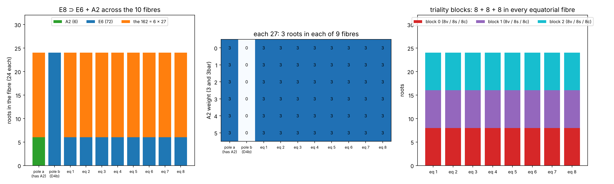

*Reproduce: `python3 models/e6_fibres.py --no-show --save-dir figures`.* The standard embeddings `E8 > E6 + SU(3)` (240 = 72 + 6 + 6 x 27) and
`E8 > D4 + D4` (240 = 24 + 24 + 3 x 64), as used in the chirality-standard-model fork (section 4), located inside the Hopf fibres of the
Hurwitz-pair E8. All results are finite enumerations on the 240 roots, each with a negative control in the tests.
- **Exact:** `D4a = {(a, 0)}` and `D4b = {(0, b)}` are each one **whole fibre**: they are the two poles of the five-cross-polytope of base points. The other 192
  roots are the 8 equatorial fibres.
- **Exact:** the 192 split into three 64-blocks (the class of `a` modulo `(1 + i)H`; the 8v, 8s, 8c blocks of the D4 x D4 picture), and **every equatorial
  fibre has exactly 8 roots in each block**. The fibres cut the triality blocks evenly, so triality cannot be a symmetry that keeps fibres whole.
- **Exact:** the fibre rotation `R_w: (a, b) -> (a w, b w)`, `w = (-1 + i + j + k)/2`, has order 3 and no fixed vector, and **cycles the three blocks**. So the order-3
  triality of D4 x D4 used for generations is realised by a fibre rotation, a lattice automorphism.
- **Exact:** A2 = the `R_w` orbit of `(1 + i, 0)` with its negatives lies inside the pole D4a, is preserved by `R_w` (a 120 degree rotation on it), and its
  orthogonal complement is an **E6** (72 roots, rank 6, closed under reflections). `R_w` preserves E6 and the remaining 162.
- **Exact (fibre profile):** pole D4a holds the A2 (6) and 18 of the 162; pole D4b is entirely E6 (24); each equatorial fibre holds 6 of E6 and 18 of the 162.
  So E6 = 24 + 3 x 16, and its 48 equatorial roots are 16 per block (the `E6 > D4` with three 16's).
- **Exact:** the 162 give 6 A2 weights (27 roots each) and 54 E6 weights (3 roots each, norm^2 4/3). One 27 has inner products 1 x 4/3, 16 x 1/3, 10 x -2/3 from
  any of its weights (the 1 + 16 + 10 of SO(10)), and the 54 are the 27 and its negative. **Each 27-class has exactly 3 roots in each of the 9 fibres other than
  D4b: 27 = 9 x 3.**
- **Exact:** E8 has 1120 A2 subsystems with exactly two fibre profiles. 160 lie inside one fibre (10 fibres x 16 A2 in a D4); 960 meet three fibres in 2 + 2 + 2 roots.
  The fibre group has 40 orbits of size 4 (stabiliser Z6 = <-w>, the aligned kind, including ours) and 80 of size 12 on them.
- **Reading:** the chirality theorem's family 3 (`SU(3)_M`) and the triality 3 are both order-3 elements here, and `R_w` is a single fibre rotation that is a 120 degree
  rotation on A2 and a block-cycling triality on D4 x D4. The fork's own finding (`lisi/README.md`) is that the two 3's are *independent* commuting symmetries; `R_w` is
  their product on the aligned A2 and is not either one alone. I did not check this against its `check_triality_su4.py` beyond the counts that match (D4 x D4 = 24 + 24 + 3 x 64;
  E6 = 24 + 3 x 16; 27 = 1 + 16 + 10).
- **Now tested (see the next section and `TILE_E8_BRIDGE.md`):** the Chair44 count 192 = 24 panels x 8 matches the equatorial part of E8 only in shape (3 x 8 x 8), not in structure; and the
  hexagonal A2 + A2 of the Spectre's own 4D lift does embed in E8 through `R_w`, with every edge a root, though the Spectre inflation does not extend to E8.
- **Not done:** the Lie-algebra level (the 27 is shown here by roots only); real forms and signature; the Spin(11,3) Clifford model; any use of the tile.

### The tiles against E8 (`models/spectre_in_e8.py`, `models/chair_e8_192.py`; write-up in `TILE_E8_BRIDGE.md`)

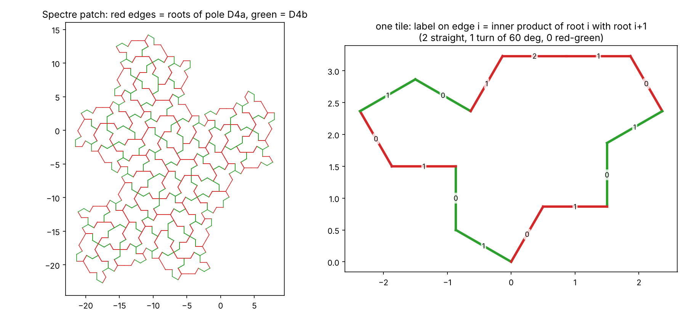

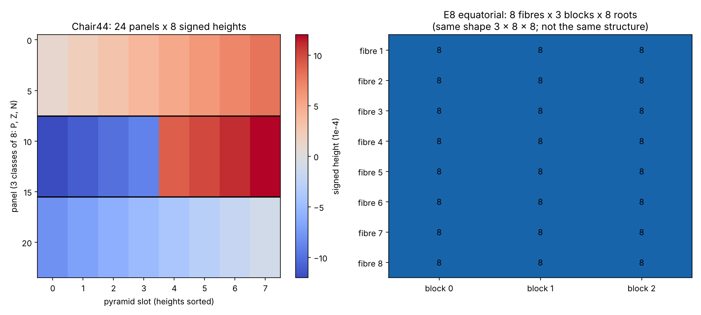

- **Exact:** the 4D lift lattice of the Spectre in `lift4d.py` (red hexagonal A2 plus green hexagonal A2, `Z[zeta_12]`) embeds isometrically in E8 as A2 + A2, using the Eisenstein
  structure given by the fibre rotation `R_w` and the two pole fibres. Every Spectre edge becomes a root (red edges in pole D4a, green in D4b), each tile outline is a closed walk of
  14 roots (8 red and 6 green for 63 tiles, 6 and 8 for the other 8), tested on 71 tiles and 518 vertices.
- **Exact, negative:** the Spectre inflation (`x^4 - 8x^2 + 1`, `lambda = (sqrt 3 + sqrt 5)/sqrt 2`) has eigenvalues of modulus other than 1 and does not extend to E8; the field `Q(lambda)`
  contains `sqrt 15` but not `sqrt 3`, `sqrt 5` or the golden ratio. The Spectre and the icosian E8 use different number fields.
- **Exact:** the Chair44's 192 tips are 24 panels x 8 and also 24 signed heights x 8, in three classes of 8 panels, and the labelled solid has no symmetry. Against the 192 equatorial roots of E8
  (8 fibres x 3 blocks x 8) the shape 3 x 8 x 8 matches but the structure does not: negation fixes every E8 block while the height flip exchanges two Chair classes, and E8's set has a free
  action of order 24 where the Chair has none. So `192 = 24 x 8` stays a coincidence of counts.
- **Hypothesis, untested:** `sqrt 15 = sqrt 3 x sqrt 5` points to a lattice that combines the Eisenstein and icosian structures; see `TILE_E8_BRIDGE.md`, section 3, for tests that could fail.

### Corner locality of the abelian Wilson loop (`models/wilson_corner_locality.py`; write-up in `TILE_E8_BRIDGE.md`, section 4)

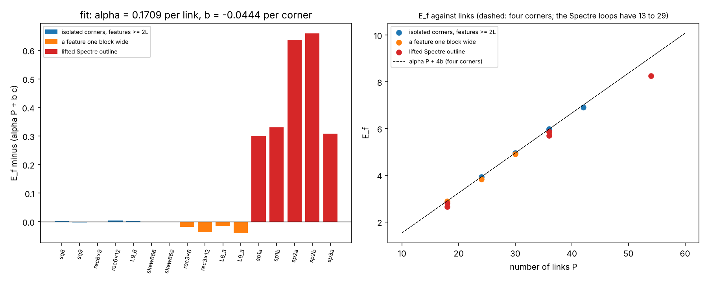

- **Numeric:** using the abelian first-step operators of the fork `4D_Wilson_Loop_RG` (CC0), `E_f = alpha P + b c` with `alpha = 0.1709` per link and `b = -0.0444` per corner holds to 0.006 for seven loops whose features
  are at least 2L wide (squares, rectangles, L-shape, skew loops); squares reproduce the fork's published values to 1e-3. It fails by 0.016 to 0.039 for features one block (L = 3) wide, and by 0.30 to 0.66 for the Spectre
  outline lifted to Z^4 (dense zigzag corners).
- **Not tested:** the 60 degree corners of the hexagonal lift (the hypercubic action sees every turn as 90 degrees); any non-abelian structure, bound or proof of the fork.

### Quantum_Gravity_Lab (CC0, J. Poplett) survey

Cloned to read only. What it already holds: `qgl_e8.py` (E8 roots, Coxeter element of order 30, projection to two H4 planes,
spherical-window model set), `qgl_cqc.py` (600-cell symmetries, 25 inscribed 24-cells, equators, isoclinic rotations to the
compound of five cuboctahedra), `qgl_qsn.py` (tetragrids, 20G, Fibonacci icosagrid, 15.52 degree golden rotation),
`qgl_tiling*.py` (Chair44 cells driving a Jaynes-Cummings sensor), plus BKL/Kasner/Hopf cosmology modules.
- **Agrees with ours:** two 120-point golden shells (our Coxeter H4 plane), 600-cell neighbour structure, 25 and 10 above.
- **Hypothesis / still open there, and where we can help:** its window is a ball, not the Elser-Sloane window; its list of things not built
  includes an icosian table. `icosian_e8.py` and `e8_shells.py` give that table and exact shell/fibre counts with Z[phi] arithmetic.
  The fibre-window comparison is now done (previous section); the Voronoi (polytope) window is in `voronoi_window.py` above. Its Sadoc-Mosseri DOI note (J. Phys. A 26 vs a J. Non-Cryst. Solids
  entry) is unresolved and not settled here.
- Nothing from QGL was copied; the check above was written from scratch.

### Not yet run

Nothing connecting these structures to the tile, the Chair44 or a quasicrystal's point selection (E6 placement above is root-level only). The remaining questions
are in section 3.

## 1. Sources: the E8 lattice, the Hopf fibration and quasicrystals

**Sadoc, J.F. and Mosseri, R. (1993). "The E8 lattice and quasicrystals."** *Journal of Non-Crystalline Solids* 153-154,
247-252. doi:10.1016/0022-3093(93)90351-W.
<https://www.sciencedirect.com/science/article/abs/pii/002230939390351W> (**Fetched**: bibliographic data and abstract
only, not the paper.) The abstract: a modified cut-and-projection method for quasiperiodic structures from E8; the lattice
is cut into shells round a vertex, the shells are embedded in 7-spheres; with the Hopf fibration the sites are grouped into
3-sphere fibres of 24 sites (or multiples of 24), and a whole fibre is selected or rejected by simple arithmetic criteria;
this gives a shell-by-shell analysis of a 4D quasicrystal with {3,3,5} symmetry, reducible to a 2D-1D construction like
the Fibonacci chain; the number of points per shell has an arithmetic formula; the 4D quasicrystal can be sliced into
lower-dimensional ones with icosahedral and tetrahedral symmetry.

**Notes (as given).** The E8 shelling and the S7 Hopf fibration: the high-dimensional E8 lattice is layered into concentric
shells that embed the sites in S7; the octonionic Hopf fibration S7 -> S4 with S3 fibres gathers families of shell sites
into S3 fibre loops; each fibre holds 24 points arranged as a 24-cell and is accepted or rejected as a whole, which turns
an 8D selection problem into a sequential 2D-1D one; the 240 roots of E8 (the Gosset polytope) projected this way give the
Elser-Sloane quasicrystal (ESQC) and separate into 10 disjoint S3 fibres, each a 24-cell, together the twin 600-cells
of the ESQC. The first half of this is in the Sadoc-Mosseri abstract above; the 240 = 10 x 24 split and the Elser-Sloane
statement are **not** in the abstract and are not checked here.

**Quantum Gravity Research, "A Deep Link Between 3D and 8D (VISUALIZATION)"** (page dated 2 January 2017, modified
18 January 2021; no author named).
<https://quantumgravityresearch.org/portfolio/a-deep-link-between-3d-and-8d/> (**Fetched**.) The page says the E8 lattice
reaches 4D "by one of two processes: cut-and-project, or Hopf mapping", that both give the Elser-Sloane quasicrystal, and
that a 3D "Compound Quasicrystal" is an exact subspace of their "QSN". It gives no derivation and calls the link
"deeply related"; it is a visualisation page, not a proof. It says "Hopf mapping", not "Hopf fibration".

**Gluck, H., Warner, F. and Ziller, W., "The geometry of the Hopf fibrations"** (as named by the file
`GluckWarnerZiller-HopfFibrations.pdf`).
<https://ncatlab.org/nlab/files/GluckWarnerZiller-HopfFibrations.pdf> (**Not opened**; the title is read from the file name,
check it before citing.)

**Elser, V. and Sloane, N.J.A., "A highly symmetric four-dimensional quasicrystal"**, *J. Phys. A* 20 (1987) 6161 (from
memory, **Not opened**; check the details).

**HAL record hal-04898979v1.** <https://hal.science/hal-04898979v1> (**Not opened**: the fetch was stopped by the site's
bot protection, so title and authors are unknown to this file. Please paste the title.)

**Video.** <https://www.youtube.com/watch?v=W9FUnww7Id8&t=567s> (**Not opened**; the time 567 s is from your link.)

## 2. Sources used by the models

- **Chair44 pyramid data**: Tsiokos, via `ioannist/six-birds-tiles` (CC BY 4.0); see `models/data/README.md`.
- **Tight-binding on aperiodic tilings**: your `quantum-lattice` fork, `extras/` (`TILINGS.md`, `HOPF_INSULATOR.md`);
  numbers it reports that were reproduced here: V, E, F = 3734, 4292, 559 and E in [-2.434, 2.434] (`models/_tb.py`).
- **Hopf insulator, Berry bundle**: Moore, Ran and Wen, *PRL* 100, 186805 (2008) and Deng et al., *PRB* 88, 201105 (2013),
  as quoted in `HOPF_INSULATOR.md` (**Not opened** here).

## 3. Questions this gives us (none tested yet; results move up when they are)

Exact things we could check with small code, independent of the papers' claims:

1. **Counting (done, `models/hopf_shells.py`).** 240 = 10 x 24 and 120 = 5 x 24 are built and verified (see Results). The icosian construction was then built (`models/icosian_e8.py`) and is the same fibred root system as the Hurwitz one, up to an
   isometry. The shells beyond the roots are in `models/e8_shells.py`; open: the papers' own window and shell formula, and the 4D point set.
2. **A count that looks alike.** Chair44 has 192 pyramid tips = 24 panels x 8, and 192 = 8 x 24. Tested in `models/chair_e8_192.py` (see Results and
   `TILE_E8_BRIDGE.md`): the shapes match, the structures do not, so it is still a coincidence of counts.
3. **Selection rules.** The papers decide a whole fibre at once, and the construction ends as a Fibonacci-like sequence.
   The Spectre has its own inflation (`spectre_patch.substitution_matrix`). A comparison of the two growth laws is
   possible (eigenvalues of the matrix against the shell counts), but nothing says they should agree.

Guesses, not claims:

4. Is there any use for fibres in the sense of model 6 (curves joining a vertex to a tip) in a cut-and-project picture?
   There the fibre is a set of points over a point of the base; ours is a curve. The shared word is the only link found so
   far (see the survey in `models/README.md`).
5. The tile has 14 vertices and the Chair44 is 3D and aperiodic; no known construction takes the Spectre to E8. If one
   exists it would be the first thing to cite here.

## 4. The chirality-standard-model fork (read only)

Cloned for reading from `brentharts/chirality-standard-model` (a fork of E. Mostaque's repository). Its licence is *all rights reserved*, private review only,
so **nothing was copied**; `models/e6_fibres.py` is written from the standard definitions of the root systems. What was read: `README.md`, `LICENSE.md`, and
`lisi/README.md` (the Lisi bridge: E8 > E6 x SU(3) and E8 > D4 x D4, triality against SU(4), Spin(11,3), Z3 x Z3 grading). **Not opened:** the paper, the Lean code,
the website, and the 14 scripts themselves; the counts they report were reproduced here only where stated in section "E6 and the fibres".
Claimed there (theorem over a stated domain): `E8 > E6 + SU(3)_M` with `V = 27 x 3` is the unique pair with chirality and a non-zero cubic radical; not re-proved here.

## How to add an entry

Sources: name, venue, year, link, and one of Fetched / Notes / Not opened. Results: the figure (in `figures/`), the command that makes it, and Exact / Numeric / Hypothesis. Quote what a source says before saying what it means for
us, and keep what a source claims apart from what a test here shows.
