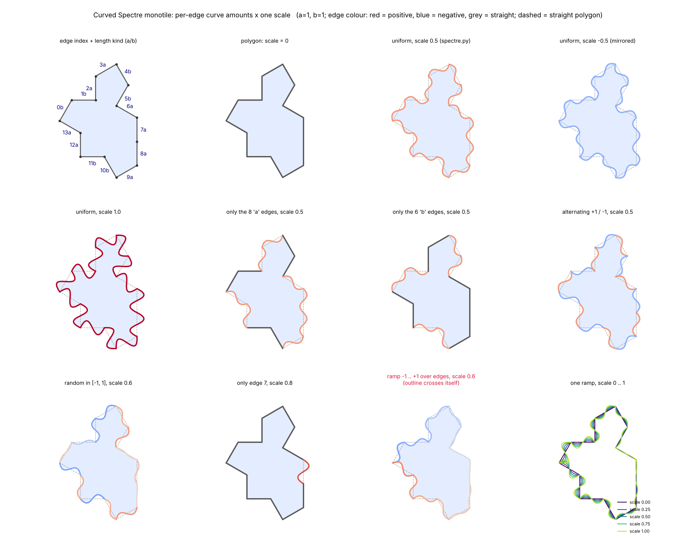

# Spectre Monotile

The Spectre Monotile project provides a simple Python tool to visualize a geometric tile pattern based on given parameters a, b, and curve_value.

## Requirements

The dependencies can usually be installed using `pip`:

```pip install numpy matplotlib opencv-python bezier```

The `bezier` package is optional: if it is not installed (it needs a compiler on some platforms), `spectre.py`
automatically falls back to `bezierpy.py`, a small pure-Python implementation with no dependencies.
`python3 bezierpy.py` runs its self test.

## Usage

To use the Spectre Monotile tool, navigate to the project directory and run:

```python3 spectre.py <a> <b> <curve_value>```  
Replace `<a>`, `<b>`, and `<curve_value>` with your desired values.

For example, to draw a spectre tile with parameters a=1, b=1, and curve_value=0.5, use:

```python3 spectre.py 1 1 0.5```


## Getting Help

To view a help message and learn about the available parameters and options, use:

```python3 spectre.py --help```

### Hidden Nerd Stuff

You can draw a shape or something like our spectre monotile using Fourier series.

To use an image:  
```python fourier_drawing.py your_image.png --num_components 100```

To use the Spectre Monotile shape (default parameters):  
```python fourier_drawing.py```

To specify parameters for the Spectre Monotile:  
```python fourier_drawing.py --a 1 --b 1 --curve_strength 0.5 --num_components 50```


### Symbolic version (SymPy → LaTeX/PDF)

`symspectre.py` computes the curved monotile exactly and symbolically in `a`, `b` and the curve strength `k`
(vertices, Bézier control points, closed-form curves, area, tangent angles) and writes a LaTeX document, compiled
to PDF if `pdflatex` is installed. The numeric values only affect the TikZ figure.

```python3 symspectre.py --a 1 --b 1 --curve_strength 0.5 --outdir out```

Use `--no-pdf` to only write the `.tex` file, and `--verify` to cross-check the symbolic curves against `spectre.py`
(needs `numpy`).

### Per-edge curve control

`spectre_operator.py` builds the curved monotile with a separate curve amount for each of the 14 edges, plus one
`scale` that multiplies them all (the effective strength of edge `i` is `scale * curves[i]`):

```python
from spectre_operator import curved_spectre
x, y = curved_spectre(a=1, b=1, curves=1.0, scale=0.5)          # same as spectre.py with k=0.5
x, y = curved_spectre(curves=[1, -1] * 7, scale=0.4)            # alternating edges
x, y = curved_spectre(curves={3: 1.0, 7: -1.0}, scale=0.6)      # only edges 3 and 7
```

Run `python3 spectre_operator.py` to execute its self tests and show a figure with the edge numbering and a set of
variations (`--no-show --save out.png` to write the figure instead of opening a window).
The area stays `2√3·a² + 3ab + √3·b²` for any amounts; very different amounts on neighbouring edges can make the
outline cross itself (`is_simple` checks this).



The figure shows the edge numbering (top left) and per-edge variations; edge colour is red for positive and blue for
negative curve amounts. Rebuild it with `make figures`.

### Makefile

```
make test        # self tests: bezierpy.py and spectre_operator.py
make verify      # symbolic (SymPy) curves vs the numeric spectre.py
make check       # test + verify
make figures     # rebuild figures/spectre_operator_variations.png
make pdf         # build/symspectre.pdf (needs pdflatex)
make show        # run the tests, then open the interactive matplotlib window
make install-min # pip install numpy matplotlib sympy (the bezier package is optional)
make clean       # remove build/ and Python caches
```

`make` on its own lists all targets.
