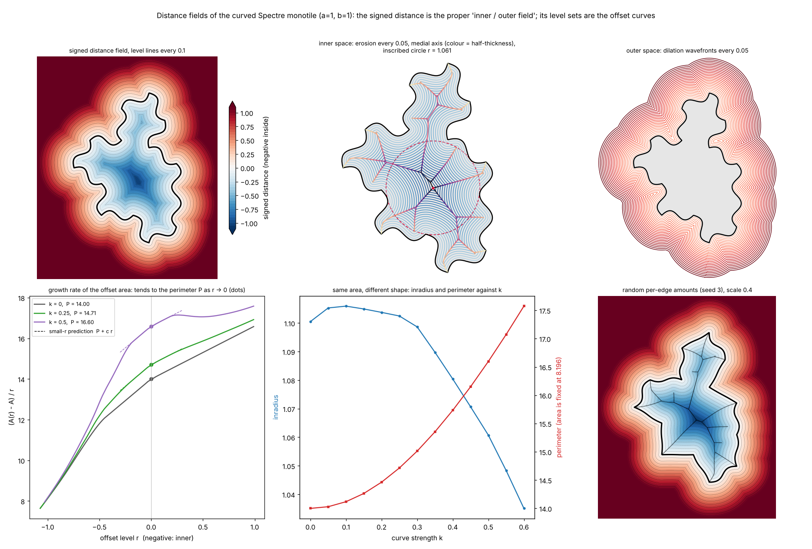
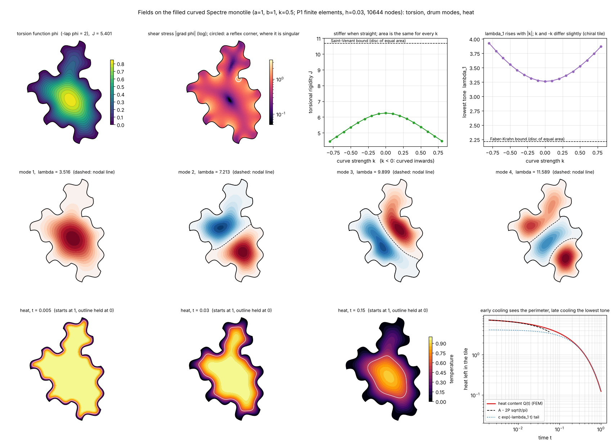
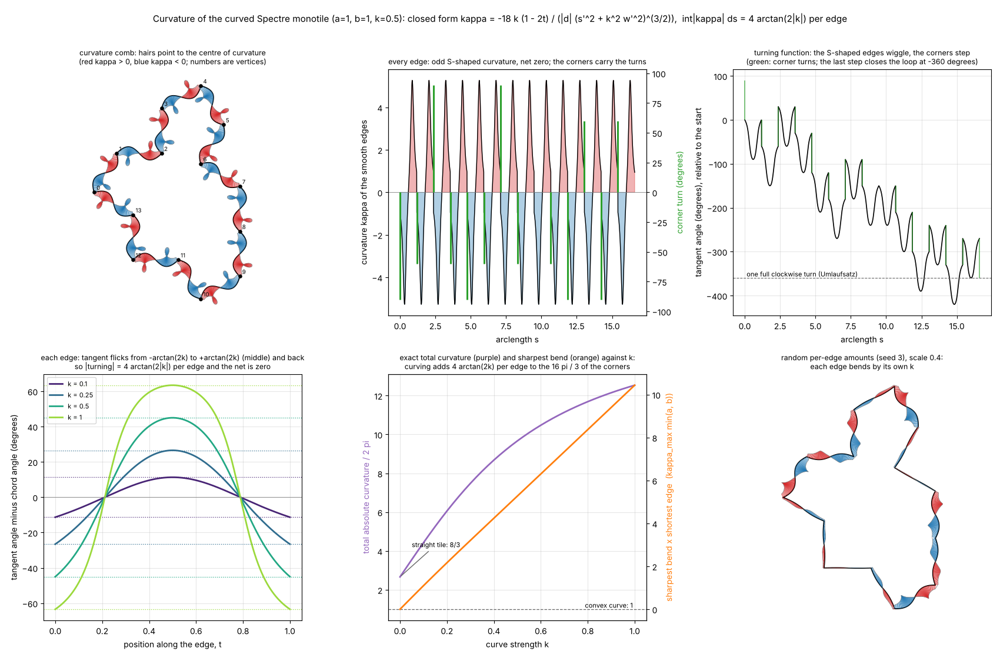
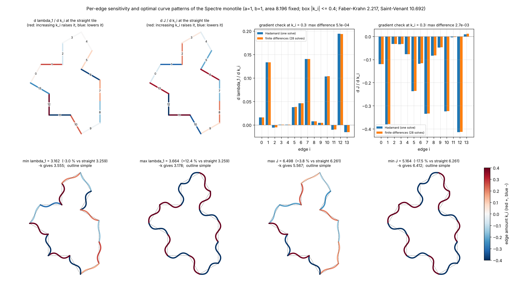
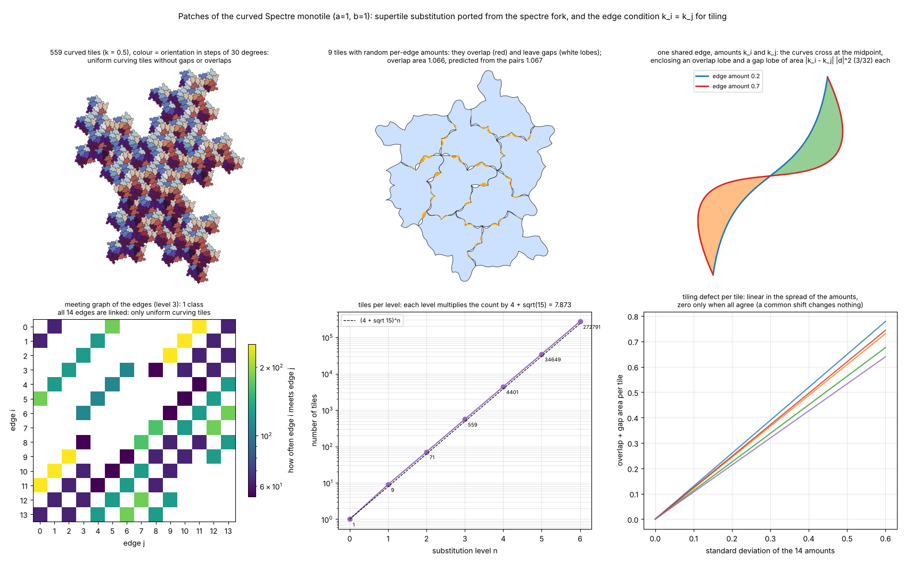
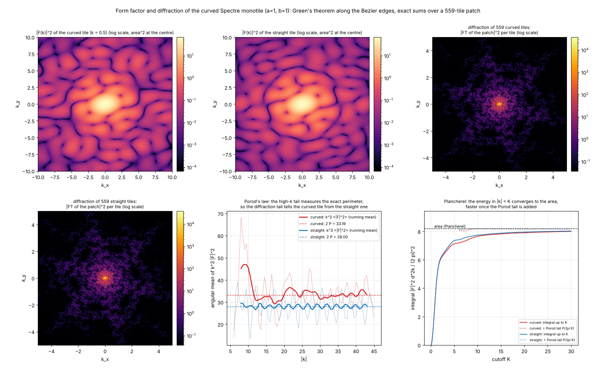
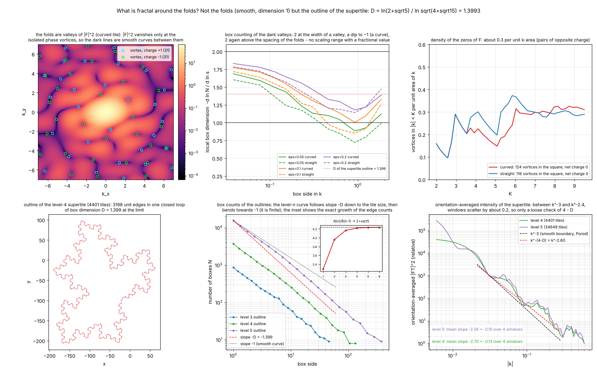
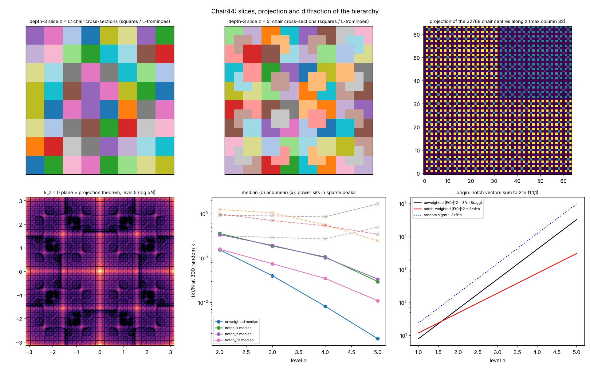
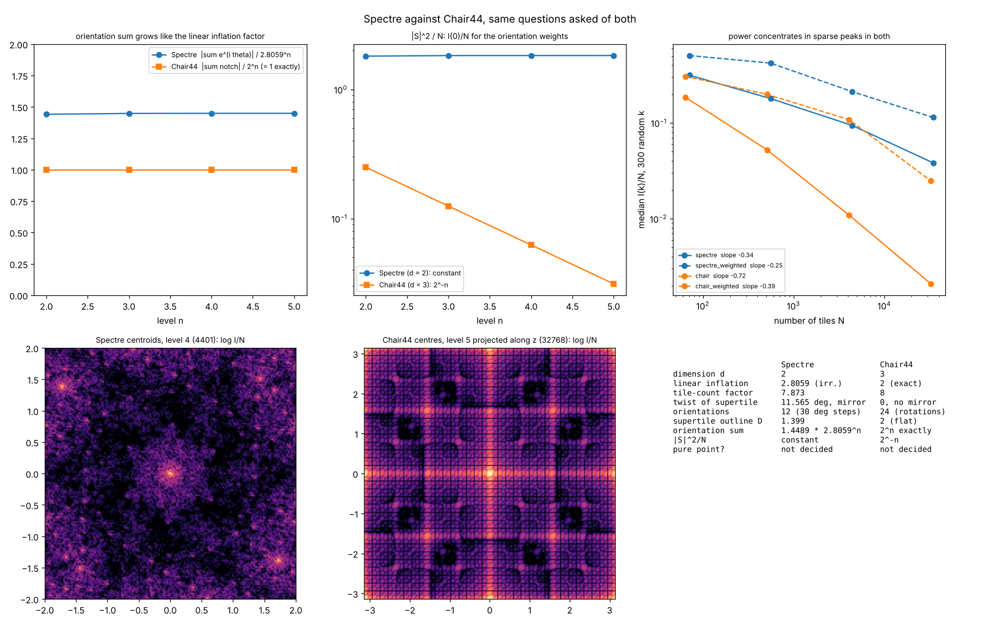

# Spectre Monotile

The Spectre Monotile project provides a simple Python tool to visualize a geometric tile pattern based on given parameters a, b, and curve_value.

## Requirements

The dependencies can usually be installed using `pip`:

```pip install numpy matplotlib opencv-python bezier```

The `bezier` package is optional: if it is not installed (it needs a compiler on some platforms), `spectre.py`
automatically falls back to `bezierpy.py`, a small pure-Python implementation with no dependencies.
`python3 bezierpy.py` runs its self test.

## Usage

To use the Spectre Monotile tool, navigate to the project directory and run:

```python3 spectre.py <a> <b> <curve_value>```  
Replace `<a>`, `<b>`, and `<curve_value>` with your desired values.

For example, to draw a spectre tile with parameters a=1, b=1, and curve_value=0.5, use:

```python3 spectre.py 1 1 0.5```


## Getting Help

To view a help message and learn about the available parameters and options, use:

```python3 spectre.py --help```

### Hidden Nerd Stuff

You can draw a shape or something like our spectre monotile using Fourier series.

To use an image:  
```python fourier_drawing.py your_image.png --num_components 100```

To use the Spectre Monotile shape (default parameters):  
```python fourier_drawing.py```

To specify parameters for the Spectre Monotile:  
```python fourier_drawing.py --a 1 --b 1 --curve_strength 0.5 --num_components 50```


### Symbolic version (SymPy → LaTeX/PDF)

`symspectre.py` computes the curved monotile exactly and symbolically in `a`, `b` and the curve strength `k`
(vertices, Bézier control points, closed-form curves, area, tangent angles) and writes a LaTeX document, compiled
to PDF if `pdflatex` is installed. The numeric values only affect the TikZ figure.

```python3 symspectre.py --a 1 --b 1 --curve_strength 0.5 --outdir out```

Use `--no-pdf` to only write the `.tex` file, and `--verify` to cross-check the symbolic curves against `spectre.py`
(needs `numpy`).

### Per-edge curve control

`spectre_operator.py` builds the curved monotile with a separate curve amount for each of the 14 edges, plus one
`scale` that multiplies them all (the effective strength of edge `i` is `scale * curves[i]`):

```python
from spectre_operator import curved_spectre
x, y = curved_spectre(a=1, b=1, curves=1.0, scale=0.5)          # same as spectre.py with k=0.5
x, y = curved_spectre(curves=[1, -1] * 7, scale=0.4)            # alternating edges
x, y = curved_spectre(curves={3: 1.0, 7: -1.0}, scale=0.6)      # only edges 3 and 7
```

Run `python3 spectre_operator.py` to execute its self tests and show a figure with the edge numbering and a set of
variations (`--no-show --save out.png` to write the figure instead of opening a window).
The area stays `2√3·a² + 3ab + √3·b²` for any amounts; very different amounts on neighbouring edges can make the
outline cross itself (`is_simple` checks this).


The figure shows the edge numbering (top left) and per-edge variations; edge colour is red for positive and blue for
negative curve amounts. Rebuild it with `make figures`.

### Distance fields: inner and outer space

`spectre_fields.py` computes the signed distance to the tile boundary (negative inside, positive outside). Its level
sets are the inner and outer offset curves, a one-parameter family sweeping through the original shape.

```python
from spectre_fields import DistanceField
f = DistanceField.tile(a=1, b=1, curves=1.0, scale=0.5)   # same arguments as spectre_operator
f.level_curves(-0.1)         # inner offset curve(s)
f.region_area(0.2)           # area of the tile dilated by 0.2
f.inradius, f.incenter       # largest inscribed circle
segments, radius = f.medial_axis()
```



What the self tests check:

- the first-order growth of the offset areas is the **perimeter** (coarea formula), and the perimeter has the exact
  closed form `spectre_operator.perimeter` = `sum |d_i| F(k_i)`;
- the second-order term depends only on the **corner turns**: `A(+r) = A + P r + c_out r²`, `A(-r) = A - P r + c_in r²`
  with `c_out + c_in = π + 2 + √3` for equal amounts on all edges (the area itself never changes with `k`);
- the **medial axis** peaks at the inscribed circle, and the distance field agrees with the exact point-to-segment
  distance of the straight tile.

Very different amounts on neighbouring edges make sharp corners and shrink the range of `r` where the small-`r`
formulas hold.

### Fields on the filled tile: torsion, drum modes, heat

`spectre_fem.py` meshes the solid tile with triangles and solves three classical problems with linear finite
elements (numpy + `scipy.sparse` only, no mesh library). The area is the same for every curve amount, so every
difference below is due to the shape alone.

```python
from spectre_fem import TileMesh
m = TileMesh.tile(a=1, b=1, curves=1.0, scale=0.5, h=0.05)   # same arguments as spectre_operator
tor = m.torsion()              # phi, J = 2*integral(phi), shear stress |grad phi| per triangle
lam, modes = m.eigenmodes(6)   # Dirichlet drum modes: -lap u = lambda u, u = 0 on the outline
Q = m.heat_content([0.01, 0.1, 1.0])   # heat left after cooling from u = 1 with the outline at 0
```



What the self tests check:

- the solver reproduces the exact **disc** and **square** results (torsional rigidity, eigenvalues, heat content);
- the tile obeys the **Saint-Venant** bound `J <= A^2 / (2 pi)` and **Faber-Krahn** `lambda_1 >= pi j01^2 / A`
  (the disc of equal area is the extremal shape) and the Polya bound `lambda_1 J / (4 A) < 1`;
- the early **heat content** is `Q(t) = A - 2 P sqrt(t / pi) + O(t)`: cooling feels the perimeter from step 1
  (`spectre_operator.perimeter`), while late cooling decays like `exp(-lambda_1 t)`;
- the torsion shear stress is **singular at the reflex corners** (it keeps growing as the mesh is refined, so
  its maximum is shown, not trusted to high accuracy), and is zero at the centre;
- the numbers converge with the mesh size, are unchanged by rotating the tile, scale exactly with `a, b`
  (`lambda ~ 1/s^2`, `J ~ s^4`), and the two chiralities `k` and `-k` have lowest tones that differ by about 1 %.

### Curvature, turning function and bending energy

`spectre_curvature.py` works out the curvature of the curved outline in closed form. For an edge with chord `d` and
strength `k` the numerator of the curvature collapses to a line, `kappa(t) = -18 k (1 - 2t) / (|d| (s'^2 + k^2 w'^2)^(3/2))`,
so every edge is an S with exactly one inflection point (at its middle) and the curvature is odd about it.

```python
from spectre_curvature import curvature_profile, total_absolute_curvature, bending_energy, max_curvature
prof = curvature_profile(a=1, b=1, curves=1.0, scale=0.5)   # kappa, tangent angle theta, corner turns along the outline
total_absolute_curvature(1, 1, 1.0, 0.5)    # exact: sum |corner turns| + sum 4 arctan(2|k_i|)
bending_energy(1, 1, 1.0, 0.5)              # integral of kappa^2 ds over the smooth edges
```



What the self tests check:

- the closed form agrees with finite differences of the Bezier edges; every edge has **zero net curvature** and its
  absolute curvature integrates to exactly **`4 arctan(2|k|)`**;
- the corner turns obtained from the Bezier control points agree with the step-1 formula, and the **Umlaufsatz** holds:
  the total turning of the clockwise tile is exactly `-2 pi`;
- the total absolute curvature of the straight tile is `16 pi / 3` (8/3 of the convex value `2 pi`, because of the
  reflex corners), and curving adds `4 arctan(2|k|)` per edge, independent of `a` and `b`;
- the bending energy agrees between the closed-form quadrature and a sum along the outline, has the right small-`k` limit,
  and scales like `1/s` when lengths are scaled by `s` (while the turning angles do not change at all);
- the sharpest bend is on the shortest edge, and `k` and `-k` are exact mirror images (`kappa` changes sign, nothing else).

### Sensitivity and optimisation over the 14 edges

The area is the same for every choice of the 14 amounts `k_i`, so the lowest drum tone `lambda_1` and the torsional
rigidity `J` of `spectre_fem.py` depend on the shape alone. `spectre_optimize.py` asks which edges matter and which pattern
of amounts is best.

```python
from spectre_optimize import MorphingTile, shape_gradients, optimize_amounts, chirality_gap
mt = MorphingTile(h=0.05)                         # one mesh, deformed (not re-meshed) for any amounts
g = shape_gradients(mt, [0.3] * 14)               # g["dlambda1"], g["dJ"]: d/d k_i for each edge, from ONE solve
best = optimize_amounts(mt, "lambda1", "min", bound=0.4)   # L-BFGS-B inside |k_i| <= 0.4
best["k"], best["value"], best["simple"]
chirality_gap(mt, best["k"])                      # lambda_1 and J for k and for -k
```



The gradients are **Hadamard shape derivatives**: `d lambda_1 / d k_i = - integral over edge i of (du/dn)^2 V_n ds` (and the
same with the opposite sign for `J`), where `V_n` is the normal speed of the edge. They need the boundary flux of a single
solve instead of 28 finite-difference solves.

What the self tests check:

- the morphed mesh equals the reference at `k_ref`, keeps the area, puts its boundary nodes exactly on the Bezier edges and
  agrees with a freshly built finer mesh;
- the Hadamard gradients agree with central finite differences of the solver (per edge, in norm and in sum), with the
  derivative along uniform curving, and across mesh sizes;
- the optimiser reaches the **same optimum from every start**, satisfies the **KKT conditions** of the box problem,
  agrees with an independent fine mesh (so it is not exploiting distorted triangles), and **random search never beats it**;
- first-order theory predicts the optimal signs: at the straight tile `lambda_1 ~ lambda_1(0) + g . k`, so the best small
  pattern is `k_i = -B sign(g_i)`;
- the **chirality gap** `lambda_1(k) - lambda_1(-k)` is first order, `2 k . grad lambda_1(0)`.

### Patches of tiles and the tiling condition

`spectre_patch.py` ports the supertile substitution of `spectre.py` in the `brentharts/spectre` fork (checked to reproduce its
transforms exactly) of the chiral aperiodic monotile of Smith, Myers, Kaplan and Goodman-Strauss [[1]](#references)[[2]](#references) (chiral aperiodic tilings also arise in molecular self-assembly [[4]](#references)) and places the tile of this repository with it. A level-`n` patch has 1, 9, 71, 559, ... tiles, and the
count grows by `4 + sqrt(15)` per level (the Perron eigenvalue of the substitution matrix).

```python
from spectre_patch import SpectrePatch
p = SpectrePatch(levels=3)                       # 559 tiles
polys = p.polygons(curves=1.0, scale=0.5)        # their curved outlines
p.edge_pairs(), p.pair_matrix()                  # which edge i of which tile meets which edge j of which tile
p.compatible_classes()                           # groups of edge indices forced to carry equal amounts
p.mismatch_area(curves, scale)                   # exact overlap + gap area for any per-edge amounts
```



**The per-edge amounts of `spectre_operator` only tile when they are all equal.** A curved edge is an S that is point
symmetric about its midpoint, so two tiles that share an edge fit exactly if both edges carry the same amount. If they differ,
the two curves cross at the midpoint and enclose an overlap lobe and a gap lobe of area `|k_i - k_j| |d|^2 (3/32)` each. In the
tiling every edge index meets every other one (the meeting graph is connected), so the compatible subspace of the 14 amounts is
the uniform line `k_i = k` only. Every other pattern, including the optimal ones of `spectre_optimize`, is a single tile that
does not tile the plane.

What the self tests check: the counts and the inflation factor from an independent substitution-matrix route; all placements are
proper rotations in multiples of 30 degrees; the tiles meet edge to edge with no overlap (also for `a != b`, which brings in the
Mystic tile with its lengths swapped); meeting edges always have equal kind and length, which pins down the cyclic shift of the
port; the lobe area against a polygon computation; and the predicted overlap `half the mismatch area` against a rasterised patch.

### Form factor and diffraction

`spectre_diffract.py` computes the Fourier transform of the tile, `F(k) = integral of exp(i k.x) over the tile`, by Green's theorem
along the 14 Bezier edges, and the exact amplitude of a whole patch as a sum over its tiles. Diffraction from real structures built on the monotile is the subject of [[3]](#references), which reports sharp Bragg peaks and chiral, pinwheel-like patterns for a hat-based structure; the calculation here is of the ideal filled tiles.

```python
from spectre_diffract import form_factor, patch_amplitude, diffraction_intensity, porod_constant
F = form_factor(k, a=1, b=1, curves=1.0, scale=0.5)        # k: array (..., 2)
I = diffraction_intensity(SpectrePatch(3), k)              # |FT of the patch|^2 per tile
```



What the self tests check: `F(0)` is the area and the small-`k` terms are the centroid and second moments; the straight tile agrees
with the exact polygon formula and the curved tile with rasterisation; placement (rotation, mirror, translation) matches a direct
integral; **Porod's law**, `k^3 <|F|^2> -> 2 P`, returns the exact perimeter of the curved and of the straight tile (they differ by
18 %), and **Plancherel's identity** `integral |F|^2 d^2k / (2 pi)^2 = area` holds with that Porod tail; the patch amplitude equals the
Fourier transform of the rasterised union. So the same perimeter shows up in the offset areas (`spectre_fields`), the heat content
(`spectre_fem`) and the high-`k` tail of the diffraction.

### What is fractal in the diffraction pattern?

The folded, brain-like ridges in the first two panels of `spectre_diffract.png` are the dark valleys of |F(k)|^2 of **one
tile**. They are not fractal. F is an entire function of k, and because it is complex, |F|^2 vanishes only at isolated
phase vortices (charge +1 or -1, about 0.3 per unit area of k, net charge 0). The dark lines are valleys that run between
the vortices, and they are smooth curves. Box counting of the valley set gives a local dimension of 2 at the width of a valley, a dip
to about 1 (a curve) and 2 again above the spacing of the folds, so no range of scales with a fractional dimension exists.
Curved and straight tiles behave the same way.

The fractal object next to the picture is the **outline of a supertile**, which is what shapes the patch diffraction in panels 3 and 4.
`spectre_fractal.py` counts its edges exactly. The number of outline edges B_n of the level-n patch is 14, 46, 182, 758, 3198,
13534, 57318 (levels 0 to 6) and obeys the integer recurrence `B(n+3) = 5 B(n+2) - 3 B(n+1) - B(n)`, whose characteristic
polynomial is `(x - 1)(x^2 - 4x - 1)`. The outline therefore grows by `r = 2 + sqrt(5)` per level while the linear size grows by
`sqrt(4 + sqrt(15))`, so

    D = ln(2 + sqrt 5) / ln sqrt(4 + sqrt 15) = 1.3993

as the box dimension (equal to the Hausdorff dimension if the graph-directed open set condition holds, which is assumed, not proved;
the recurrence is fitted to 7 terms with one check, not proved).



```python
from spectre_fractal import phase_vortices, valley_box_counts, boundary_counts, D_OUTLINE
```

Honest caveats, all visible in the figure: box counting of a finite outline approaches 1.399 slowly from below (fitted slopes of about
1.19, 1.24 and 1.29 for levels 3, 4 and 5); the Porod-type decay of the orientation-averaged intensity,
which should be `k^-(4-D) = k^-2.60` instead of the `k^-3` of a smooth boundary, is measured as -2.7 and -2.6 for levels 4 and 5 but
the individual fit windows scatter by about 0.2 (log-periodic modulation), so this is a loose check only. `python3 spectre_fractal.py --peaks`
tracks the strongest maxima of the diffraction through the levels: apart from the trivial peak at the origin (exponent 1 for
I ~ N^alpha, a Bragg peak) none of the tracked maxima grows (alpha between -0.1 and -0.5). That is a hint that the strong features
are not Bragg peaks, but it is a small search with local hill climbing, not a classification of the spectrum. It does not contradict the sharp
Bragg peaks reported in [[3]](#references), which concern a different object (a fabricated hat-based structure). Deciding whether the
diffraction measure of the substitution tiling is pure point is the question treated by the theory of model sets and of substitution
systems [[5]](#references)[[6]](#references)[[7]](#references).

What the self tests check: box counting reproduces the exact dimensions of a line, a filled square and the Sierpinski triangle; the vortex finder
recovers synthetic zeros and charges, and every vortex of the real tile refines to a true zero at two grid resolutions; the outline
edge counts and the recurrence (it predicts the stored level 6, which `--deep` recomputes in 80 s), the growth rate 2+sqrt(5), the outline being one simple closed
loop of unit edges, the growth of the geometric box counts by about r per level, the plateau at dimension 1 of the valleys, and the peak exponent of
control arrays (1 for a square lattice at a Bragg point, about 0 for the same squares at random positions).

### Chair44: unfolding, slices and projections

`chair44_core.py` holds the exact geometry of Tsiokos' Chair44 3D einstein tile [[8]](#references): a seven-cube chair (2x2x2 minus one corner),
the 48 cube frames, and the eight-chair substitution whose supertile is the chair scaled by 2. To compare a 3D tile with the Spectre we need 2D objects.

`chair44_unfold.py` unfolds the surface of the chair, a sphere of 24 unit squares (48 edges, 26 vertices; 27 convex, 18 flat and 3 concave folds),
along a spanning tree of the face adjacency graph (261,434,325,600 trees). Every net is a 24-omino. In 3,000 random trees 1,253 gave a valid net
(the other 1,747 overlap themselves), the smallest perimeter found is 28, and 2 of the nets tile the plane by translation.
Unfolding the same code on a cube gives exactly the 11 known cube nets. The supertile surface is the chair surface scaled by 2, so its net is the
chair net with each square replaced by a 2x2 block: dimension 2, no fractal outline, unlike the Spectre supertile outline (1.399).

`chair44_slice.py` takes planar slices and projections of the depth-n patch (8^n chairs, each a bounding-cube centre plus a notch direction).
A slice cuts chairs into 2x2 squares and L-trominoes; the projection along z has the k_z = 0 plane of the 3D diffraction as its Fourier transform
(checked against a 3D FFT). The 8^n centres are distinct integer points on two cosets of 2Z^3, the notch vectors sum to exactly 2^n (1,1,1)
(the mean child matrix is I/4), so the notch-weighted intensity at the origin is 4^n per component against N = 8^n for random signs, and the interface
length of the z = 0 layer is exactly 4^(n+1) - 4 * 2^n. At random wave vectors the median intensity falls by a factor of about 5 per level, which
says the power sits in sparse peaks; it does not prove that the diffraction is pure point.



### Spectre against Chair44

`chair44_compare.py` asks the same questions of both substitution tilings. Each tile becomes a point (the Spectre centroid; the centre of the chair's
bounding cube) and an orientation (e^(i theta) for the Spectre, the notch direction for the chair). The linear inflation factor is sqrt(4+sqrt(15)) = 2.8059
for the Spectre (d = 2) and exactly 2 for the chair (d = 3).

- **Orientation sum.** For the chair S_n = 2^n exactly. For the Spectre |S_n| / 2.8059^n = 1.4413, 1.4480, 1.4488, 1.4489 at levels 2 to 5. In both
  the orientation sum grows by the linear inflation factor per level, so |S|^2/N is constant for the Spectre and falls as 2^-n for the chair: the
  difference is the dimension, not the details of the tiles.
- **Twist, outline, orientations.** The Spectre supertile is turned by 11.565 degrees and mirrored at every level, with an outline of dimension 1.399 and 12
  orientations. The chair supertile is the chair scaled by 2, with no rotation, no mirror, a flat surface (dimension 2) and 24 orientations.
- **Where the power goes.** The median of I(k)/N over 300 fixed random wave vectors (k scaled by the tile size) falls with the number of tiles in both:
  log-log slope -0.34 for the Spectre centroids and -0.72 for the chair centres. This is a loose statistic from two different dimensions; it says the power sits in sparse
  peaks, and it does not decide whether either diffraction measure is pure point.



### Exact comparisons: diffraction, orientation, hyperuniformity, contacts

Five further modules, each with tests (`make test`). Results are computed or exact where stated; nothing here tests the thesis below.

- `chair44_diffraction.py`: the Chair44 centre set obeys X_n = 2X_{n-1} + (odd box minus a corner octant); its structure factor has a closed form, the Bragg peaks sit at dyadic k = 2 pi m / 2^J, and the total Bragg mass equals the density (1/7), i.e. pure point (Parseval). Weighted diffraction is only numerically consistent with this.
- `spectre_orient.py`: exact orientation recursion z_{n+1} = C conj(z_n) for the Spectre (the inflation reverses orientation, so two levels give C conj(C)); the sum grows as c lambda^n with lambda = 2.8059 and c^2 = (15 + 5 sqrt3 + 3 sqrt5 + 3 sqrt15)/20 (an identified closed form, not proved). The chair's sum is exactly 2^n.
- `orientation_spectra.py`: the same sums split by irreducible representation; the chair's non-trivial channels all have eigenvalue 2, the Spectre's harmonics give exponents h = 2, 1, 0.
- `hyperuniformity.py`: number-variance exponents of both centre sets (the chair slopes are noisy and unexplained).
- `contact_operators.py`: which native faces meet. Spectre: 14 x 14 edge matrix, 62 nonzero entries, rank 14, bipartite, one component, symmetric spectrum. Chair44 (depth 3): 24 x 24 face matrix, 93 nonzero entries, rank 24, not bipartite, 2 components. Boundary recurrences: Spectre (x-1)(x^2-4x-1), chair (x-4).
- `lift4d.py` (after Cheritat and Ma [[13]](#references)): the Spectre patch lifted to integer vectors (p, q, r, s) in Z^4 = Z[zeta_12] (even edge directions in the first pair, odd in the second), consistent over every shared vertex, with the deformation P_{a,b} = a u + b v as a linear projection. The lifted cloud has exactly two growing directions (growth by the inflation factor 2.8059 per level) and two bounded ones (extent about 2.7, stable from level 3 to 5), so the vertices form a 4:2 cut-and-project set. The bounded plane is not the Galois conjugate z -> z^5, which grows. The window's boundary count rises by about 2.3 per halving of the cell size (area by 4), so it is not a smooth curve, consistent with the fractal windows of [[11, 12]](#references); the exponent is not measured accurately here. The Chair44 centres by contrast sit in Z^3 with no internal space (rank 3, internal dimension 0), and [[15]](#references) reports that the obvious 4D analogues of the chair fail the closure test.
- `lift4d_matrix.py`: the exact inflation matrix. In the lift every step of the supertile recursion (rotation by 60 degrees, mirror, translation from the key points) is an integer map, so one level acts on the four key points as a 16 x 16 integer matrix, which reproduces the floating-point recursion to 1e-9 for three levels. Its characteristic polynomial is (x-1)^4 (x+1)^4 (x^4 - 8x^2 + 1)^2, and the key-point vector has minimal polynomial (x^2-1)(x^4-8x^2+1). The quartic has roots +-lambda and +-1/lambda with lambda^2 = 4 + sqrt(15) = 7.873, the fundamental unit of Z[sqrt 15]; the negative roots are the orientation reversal. On the invariant block the matrix is the companion matrix of x^4 - 8x^2 + 1 (determinant 1, trace 0): two expanding and two contracting directions, contraction 1/lambda on the internal plane. The Chair44 inflation is 2 I on Z^3, determinant 8 and no contracting direction. The internal plane is now derived exactly (`exact_bounded_plane`): a functional is bounded on the supertile corners iff it kills the expanding part of every iterate of the key-point vector; since every level mirrors the frame, the odd iterates must be mirrored first, and then the expanding parts span only 2 dimensions. The annihilator is a 2 x 4 matrix with entries in Q(sqrt 15) (for example (5+3 sqrt15)/11, (16+3 sqrt15)/11, -(12+5 sqrt15)/11, 0 in the (p,q,r,s) coordinates of `lift4d.py`), and it agrees with the numerically fitted plane to principal cosines above 1 - 1e-6. Mirroring is why a fixed plane cannot be used on every level's frame: the bounded plane of one frame is the mirror image of the next.

### Makefile

```
make test        # self tests: bezierpy.py, spectre_operator.py, spectre_fields.py, spectre_fem.py, spectre_curvature.py, spectre_optimize.py, spectre_patch.py, spectre_diffract.py, spectre_fractal.py, chair44_unfold.py, chair44_slice.py, chair44_compare.py
make verify      # symbolic (SymPy) curves vs the numeric spectre.py
make check       # test + verify
make figures     # rebuild every figure in figures/
make pdf         # build/symspectre.pdf (needs pdflatex)
make show        # run the tests, then open the per-edge variations window
make show-fields # run the tests, then open the distance-field window
make show-fem    # run the tests, then open the finite-element window
make show-curvature # run the tests, then open the curvature window
make show-optimize # run the tests, then open the optimisation window
make show-patch  # run the tests, then open the patch window
make show-diffract # run the tests, then open the diffraction window
make show-fractal # run the tests, then open the fractal analysis window
make install-min # pip install numpy scipy matplotlib sympy (the bezier package is optional)
make clean       # remove build/ and Python caches
```

`make` on its own lists all targets.

## Motivation and context

The tools here are built around one working thesis of the author, which is a hypothesis and not a result of this repository: the Big Bang was not a
point-like singularity but a flat two-dimensional one, the flat surface is connected to the Spectre monotile, and the emergence of three-dimensional space is
connected to Chair44 [[8]](#references). Nothing computed here tests that thesis; the code only works out exactly what the two tilings do (twist, nets, slices,
diffraction, orientation sums), so that any such connection can be stated against numbers.

Two background points, kept separate from the thesis. First, the Newtonian field of an infinite uniform flat sheet of surface density sigma is constant,
g = 2 pi G sigma, independent of distance, because the mass in view grows as r^2 exactly as the force per unit mass falls as 1/r^2; opposed sheets can cancel
such fields. That is classical and exact for an infinite sheet. Second, ghost-free bimetric gravity [[9]](#references) gives dynamics to a second metric,
and a pre-geometric origin for it has been proposed [[10]](#references); a dual-sheet picture of the initial state is the kind of reading that a bimetric
setting invites, but the dual-sheet cosmologies themselves are not cited here, so no claim about them is made.

## References

1. D. Smith, J. S. Myers, C. S. Kaplan and C. Goodman-Strauss, *An aperiodic monotile*, Combinatorial Theory **4**(1) (2024).
2. D. Smith, J. S. Myers, C. S. Kaplan and C. Goodman-Strauss, *A chiral aperiodic monotile*, Combinatorial Theory **4**(2) (2024).
3. Y. Moritake, M. Takiguchi, T. Aihara and M. Notomi, *Chiral diffraction from aperiodic monotile structure*, Nature Communications **17**, 6085 (2026). <https://doi.org/10.1038/s41467-026-75023-7>
4. J. Voigt, M. Baljozović, K. Martin et al., *An aperiodic chiral tiling by topological molecular self-assembly*, Nature Communications **16**, 83 (2025). <https://doi.org/10.1038/s41467-024-55405-5> ([article](https://www.nature.com/articles/s41467-024-55405-5); [press summary](https://www.sciencedaily.com/releases/2025/02/250213144446.htm)). Context: a chiral aperiodic tiling arising from molecular self-assembly on a surface.
5. J.-Y. Lee and R. V. Moody, *Lattice substitution systems and model sets*, Discrete Comput. Geom. **25**, 173-201 (2001).
6. M. Schlottmann, *Generalized model sets and dynamical systems*, in *Directions in Mathematical Quasicrystals*, CRM Monograph Series **13**, AMS, 143-159 (2000).
7. J.-Y. Lee, R. V. Moody and B. Solomyak, *Consequences of pure point diffraction spectra for multiset substitution systems*, Discrete Comput. Geom. **29**, 525-560 (2003).
8. I. Tsiokos, *A Strongly Aperiodic Monotile in Three Dimensions*, arXiv:2609.19214, and *Matching Rules for a Three-Dimensional Strongly Aperiodic Monotile*, arXiv:2609.23783 (the Chair44, or R44, tile); shape, substitution children and contact atlas from <https://github.com/ioannist/six-birds-tiles> (CC BY 4.0). The geometry here is re-implemented independently.
9. S. F. Hassan and R. A. Rosen, *Bimetric gravity from ghost-free massive gravity*, Journal of High Energy Physics **2012**, 126 (2012). <https://link.springer.com/article/10.1007/JHEP02(2012)126>. Context: a ghost-free theory with a massless and a massive spin-2 field, obtained by giving the reference metric of ghost-free massive gravity its own dynamics.
10. *Pre-geometric origin of ghost-free massive bigravity*, Physics Letters B (ScienceDirect article S0370269326008397). <https://www.sciencedirect.com/science/article/pii/S0370269326008397>. Authors and details not verified: the publisher page could not be read from here, so check the entry before publishing.
11. M. Baake, F. Gähler, J. Mazáč and A. Mitchell, *Diffraction of the Hat and Spectre tilings and some of their relatives*, arXiv:2502.03268. The diffraction of the Hat and the Spectre is pure point; the model-set windows have fractal boundaries.
12. M. Baake, F. Gähler, J. Mazáč and L. Sadun, *On the long-range order of the Spectre tilings*, arXiv:2411.15503. Pure point diffraction and dynamical spectrum of the Spectre tilings, from a 4:2-dimensional cut-and-project scheme with windows of Rauzy fractal type.
13. A. Chéritat and N. Ma (initial idea N. Ma; contributions P. Mostert), *4D lift of the tilings by the Smith et al. aperiodic monotile*, web page. <https://www.math.univ-toulouse.fr/~cheritat/2023-monotile/4D-lift/>. The deformable outlines Tile(a,b) are projections of one path in 4D whose unit segments lie in the first two coordinates (red) or the last two (green), projected by (u,v) -> au + bv; adjacent tiles share edge colours, so the whole tiling lifts consistently to 4D (for the Spectre, tiles turned by an odd multiple of 30 degrees swap colours). Relevant to the 4:2-dimensional cut-and-project picture of reference 12.
14. C. S. Kaplan, *The Path to Aperiodic Monotiles*, arXiv:2509.12216. A retrospective on aperiodic monotiles, from Penrose's kite and dart and Gardner's question to the hat; also covers Heesch and isohedral numbers.
15. D. Kamenetsky, *Towards Strongly Aperiodic Monotiles in Higher Dimensions*, arXiv:2610.00916. Extends the Chair44 mechanism (corner-deleted hypercube with corner and socket markings) to R^N; reproduces the 3D Chair44 counts and shows the marking is unique up to conjugation, while the tested 4D candidates fail the self-similarity test, leaving it an open finite search. The contribution statement says an AI agent did the derivations, software and writing, with the author verifying the manuscript, so treat it as not independently reviewed.
