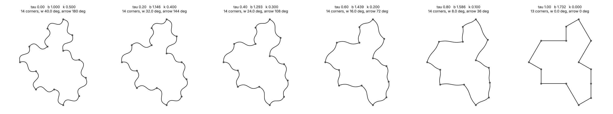

# The Spectre–Hat Collinearity Flow

`spectre_hat_collinearity_flow_model.py` moves one editable tile (`spectremodel.Tile`) between the
curved Spectre and the straight Hat with a single parameter `tau` in `[0, 1]`. This note says what
the flow is, what it needs from the geometry of `spectremodel.py`, and where it differs from the
first sketch of the idea.



## Idea

The Hat is `Tile(1, √3)` and has 13 vertices. The Spectre family starts at `Tile(1, 1)` and has a
14th vertex. Going from one to the other should not be a snap: the 14th vertex should fade out
because its turning angle goes continuously to zero, at which point it is an ordinary point of a
straight side and the polygon has 13 corners. The curved edges of the Spectre should go straight at
the same time.

(That the Hat is `Tile(1, √3)` and the Spectre is `Tile(1, 1)` is taken from the notes; this
document and the code check the geometry of the model, not that identification.)

## The flow

| quantity | law | tau = 0 (Spectre) | tau = 1 (Hat) |
|---|---|---|---|
| edge lengths `a`, `b` | `a = 1`, `b = 1 + (√3 − 1)·tau` | `b = 1` | `b = √3` |
| curve strength `k` | `k0·(1 − tau)` | `k0` | `0` (straight edges) |
| turn of the 14th vertex `w` | `w0·(1 − tau)` | `w0` (default 30°) | `0` (flat) |
| arrow angle | `π·(1 − tau)` | `π` | `0` |

The arrow angle is a parameterisation from the notes; nothing in the outline measures it.

### The 14th vertex and its edge directions

In the standard layout of `spectremodel.py` the 14 edge *directions* are fixed; `a` and `b` only
change lengths. Consequently every vertex turns by the same angle at every `tau` (all multiples of
30°), and exactly one vertex is flat from the start: **P₈**, where edges 7 and 8 both point along
`(0, −1)`. With only `a` and `b` changing, the polygon has 13 corners for every `tau`, so nothing
collapses.

To get a real 14 → 13 collapse the flow *opens* P₈. The chord `P₇ → P₉` stays where it is and P₈ is
pushed outward, perpendicular to it, by

    h(tau) = a · tan(w(tau) / 2).

Then, for every `tau`:

* edge 7 points along `−90° + w/2` and edge 8 along `−90° − w/2` (their directions change),
* both have length `a / cos(w/2)`,
* the turn at P₈ is exactly `−w` (clockwise, like every convex corner of the tile),
* P₇ and P₉ turn by `−60° + w/2` instead of `−60°`; the three changes cancel, so the total turn
  stays `−360°` and the outline stays closed,
* no other vertex moves.

At `tau = 1`, `w = 0`, P₈ is back on the chord and the tile is the straight `Tile(1, √3)`.

With `corner_deg=0` the opening is switched off and the flow is just the plain `Tile(a, b)` family
with P₈ flat all along.

### Values for the default flow (`k0 = 0.5`, `w0 = 30°`)

| tau | b | k | w (deg) | h | length of edges 7, 8 | corners | area |
|---|---|---|---|---|---|---|---|
| 0.00 | 1.0000 | 0.500 | 30.0 | 0.2679 | 1.0353 | 14 | 8.4641 |
| 0.25 | 1.1830 | 0.375 | 22.5 | 0.1989 | 1.0196 | 14 | 9.6361 |
| 0.50 | 1.3660 | 0.250 | 15.0 | 0.1317 | 1.0086 | 14 | 10.9259 |
| 0.75 | 1.5490 | 0.125 | 7.5 | 0.0655 | 1.0021 | 14 | 12.3328 |
| 1.00 | 1.7321 | 0.000 | 0.0 | 0.0000 | 1.0000 | 13 | 13.8564 |

The area is `2√3·a² + 3ab + √3·b² + a·h`; the last term is the triangle added by opening P₈.

## Facts about `spectremodel.py` that the flow relies on

* **Curvature does not change corner angles.** The handle offset `d/2 − k·n` is the chord `d`
  rotated by the fixed angle `atan(2k)`, the same for both edges at a vertex. So at every vertex the
  curve turns by exactly the polygon's turning angle, for every `k`. `k` only turns each edge into
  an S-shaped curve about its chord. The curve therefore has a corner at P₈ exactly when the polygon does.
* **The untwisted area ignores `k`**: each S-curve encloses zero net area against its chord, so the
  area equals the polygon area (`Tile.area()` is exact for the Bézier edges).
* The vertex count is read from turning angles (`effective_vertex_count`, polygon or curve tangents);
  it is 14 for `tau < 1` and 13 at `tau = 1` when `w0 > 0`.

## Differences from the first sketch

* The sketch's coordinate table `V_k(tau)` and its cross product `C(tau) = (√3/4)(1 − tau)` do not
  match the edge vectors of `spectre.py` / `spectremodel.py`, which have only multiples of 30° as
  turns; no vertex there has a 150° interior angle. The model's own version of the same quantity,
  the cross product of the two edges at P₈, is `C = −(a² + h²)·sin(w)`. It is non-zero for `tau < 1`,
  `0` at `tau = 1`, and shrinks monotonically, but it is not linear in `tau`.
* The default `w0 = 30°` reproduces a 150° interior angle at the 14th vertex as in the sketch, but it
  is a choice: the opened P₈ is a deformation added by the flow, not a corner of the original Spectre
  polygon of `spectremodel.py` (where P₈ is flat). At `tau = 0` the tile is therefore the plain
  `Tile(1, 1, k0)` only if `corner_deg=0`.
* The direction in which P₈ opens (outward) and the choice to keep `P₇ → P₉` fixed are design
  decisions. Other closure-preserving openings exist.

## Usage

```python
from spectre_hat_collinearity_flow_model import SpectreHatFlow

flow = SpectreHatFlow(k0=0.5, corner_deg=30.0)   # tau = 0
flow.tau = 0.4                                   # moves b, k and the opening of P_8 together
x, y = flow.tile.outline(60)                     # flow.tile is a live spectremodel.Tile
flow.effective_vertex_count()                    # 14 here, 13 at tau = 1
flow.vertex_report()                             # turn of each vertex (polygon and curve)
tiles = flow.frames(8)                           # independent tiles for tau = 0 ... 1
```

Setting `tau`, `k0` or `corner_deg` re-lays the tile out, so vertices moved by hand go back to the
layout; twists and `data` are kept.

Command line:

```
python3 spectre_hat_collinearity_flow_model.py --tests-only
python3 spectre_hat_collinearity_flow_model.py --frames 6 --corner 40 --no-show --save figures/spectre_hat_flow.png
python3 spectre_hat_collinearity_flow_model.py --tau 0.5 --report --no-show --save /tmp/t.png
```

## Tests

`--tests-only` runs 14 self tests (all pass). They check, among other things:

* the end points: `Tile(1, 1, k0)` with `corner_deg=0`, and the straight `Tile(1, √3)` at `tau = 1`;
* the linear laws, and that `tile` is live while `tile_at` and `frames` are independent;
* edge directions `−90° ∓ w/2`, lengths `a / cos(w/2)`, closure, and that only P₈ moves;
* turns at P₇ and P₉, and that the total turn is `−360°`;
* 14 corners for `tau < 1` and 13 at `tau = 1`, for polygon and curve tangents;
* curve corners equal polygon turns for every `tau` and `k`;
* area `= polygon formula + a·h`, for several `k`;
* input validation (failed sets leave the state unchanged).

## Open questions

* Is the opened 14th vertex the right model of the Spectre's extra vertex, or should the flow start
  from the polygon of `spectre.py` and use another vertex or direction change?
* The arrow angle is not tied to the geometry yet. A measurable version (for example the tangent
  direction at the two ends of the collapsing edge pair) would turn the notes' singularity picture
  into something the tests can check.
