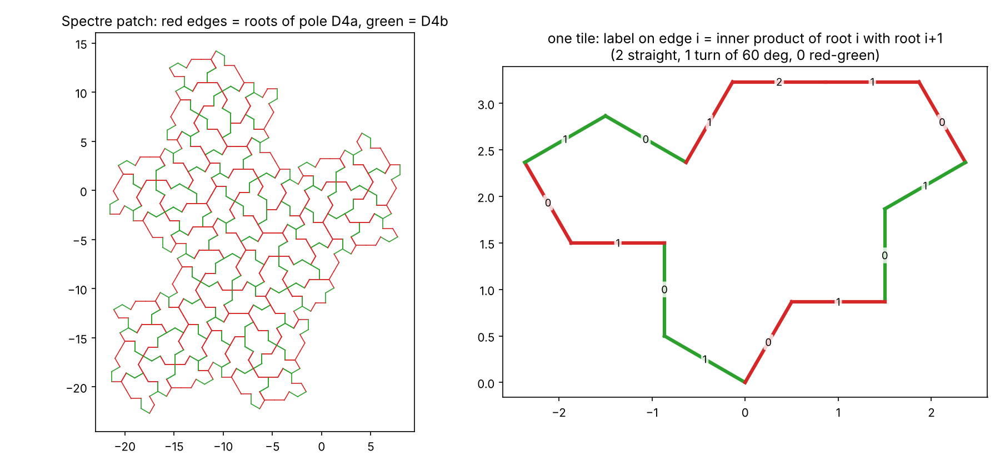
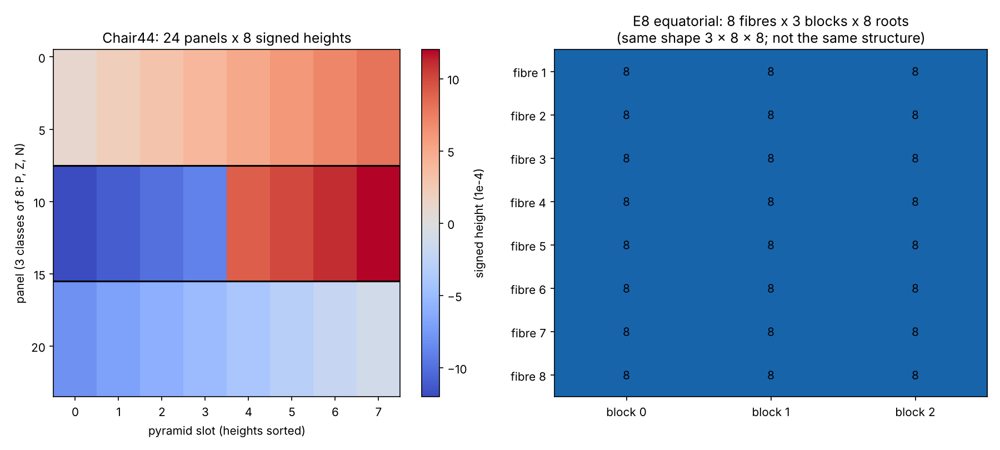
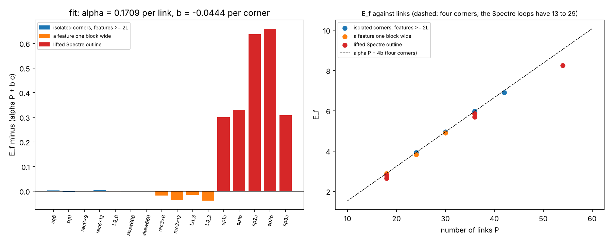

# Do the tiles touch E8? The Spectre's hexagonal lattice and the Chair44's 192

Two loose ends from `QUANTUM_GRAVITY.md` are examined here with code. Everything is labelled **Exact** (a finite enumeration or an identity, tested),
**Numeric** (tested to a stated tolerance) or **Hypothesis** (not shown). Nothing here is a claim about physics.

1. *"The Chair44 count 192 = 24 x 8 equals the equatorial part of E8."* (`models/chair_e8_192.py`)
2. *"The hexagonal A2 and the Eisenstein structure on E8 might relate to the Spectre's hexagonal geometry."* (`models/spectre_in_e8.py`)

**Short answer.** The second is real and exact in one precise sense: the 4D lattice that the repository already uses to lift the Spectre
(`lift4d.py`, the Cheritat-Ma lift) is the sum of two hexagonal lattices, and that sum sits inside E8 as the Eisenstein structure of E8 predicts,
with every Spectre edge a root. But the Spectre's own inflation does not extend to E8, and its number field is not the golden-ratio field of the
icosian E8. The first is a match of shape only: the two sets have different structure, and the two most natural identifications are ruled out.

## 1. The Spectre inside E8 (`models/spectre_in_e8.py`)

**What `lift4d.py` already says** (the repository's own code; the Cheritat-Ma attribution is as written there, I did not open that paper).
Every Spectre edge is a unit vector at a multiple of 30 degrees. Even multiples (*red*) are hexagonal vectors `p + q w`, `w = e^{i pi/3}`; odd multiples
(*green*) are `z (r + s w)`, `z = e^{i pi/6}`. A vertex gets integer coordinates `(p, q, r, s)`, and its plane position is `u + z v` with `u = p + q w`,
`v = r + s w`. So the lift lattice is `Z[zeta_12] = Z[w] + z Z[w]`: a red A2 plus a green A2.

**The new step.** In the Hurwitz-pair model of E8 (`models/e6_fibres.py`) the fibre rotation `R_w: (a, b) -> (a w, b w)` has order 3 and no fixed vector, so it makes E8
a rank-4 module over Z[omega]. Take `r1 = (1 + i, 0)` in the pole fibre D4a and `r2 = (0, 1 + i)` in the pole fibre D4b. They are Hermitian-orthogonal. Define

    embed(p, q, r, s) = (p + q (1 + R_w)) r1 + (r + s (1 + R_w)) r2        (1 + omega = w)

- **Exact:** `embed` is an isometry (up to the factor 2) from the lift lattice, with the red-orthogonal-green form, into E8. So the lift lattice is **A2 + A2 inside E8**.
  Tested on all 518 vertices of the 71-tile level-2 patch, injective, 4000 random pairs.
- **Exact:** every edge of every tile becomes a **root** of E8: red edges are roots of the pole D4a, green edges are roots of D4b. Each tile outline is a closed walk of 14 roots
  (8 red and 6 green for 63 of the 71 tiles, 6 red and 8 green for the other 8, which differ by an odd multiple of 30 degrees; the corner types are the same for all 71).
- **Exact:** for consecutive edges of the same colour the E8 inner product is 2 cos(turn); for a red-green pair it is 0 (right panel of the figure).
- **Negative control:** a second root that is orthogonal to `r1` but not Hermitian-orthogonal breaks the isometry (196 of 200 pairs off).

**What does not carry over.**
- **Exact:** the Spectre inflation (`lift4d_matrix.py`) has 4D block with characteristic polynomial `x^4 - 8 x^2 + 1`, roots `+-lambda, +-1/lambda`,
  `lambda = (sqrt 3 + sqrt 5)/sqrt 2`, `lambda^2 = 4 + sqrt 15` (about 2.8059). It has eigenvalues of modulus other than 1, so it is not an isometry of E8, and every
  automorphism of E8 has finite order. The inflation does **not** extend to the E8 root system.
- **Exact:** the field generated by `lambda` is `Q(sqrt 6, sqrt 10)` of degree 4. It contains `sqrt 15 = sqrt 3 x sqrt 5` but **neither `sqrt 3`, nor `sqrt 5`, nor the golden ratio**.
  The icosian E8 and its shells (`models/icosian_e8.py`, `models/e8_shells.py`) live in `Z[phi]`, so the two aperiodic structures use different number fields.
- The Spectre's selection of sites is not a ball or Voronoi window: the window in the contracting plane has a fractal boundary (`lift4d.py`, `lift4d_matrix.py`). Our window results
  (`models/fibre_window.py`, `models/voronoi_window.py`) do not transfer.

**Hypothesis (not shown):** the product `sqrt 15 = sqrt 3 x sqrt 5` (hexagonal field times icosahedral field) suggests a construction that combines E8's Eisenstein structure with its
icosian structure, so that one object has both the hexagonal vectors of the Spectre and the golden ratio of the 4D quasicrystal. I found nothing that does this, and the inflation test above says it
would not be an isometry of E8.

**Orientation, untested:** I chose `omega` to act as `R_w`; the other choice (`R_w` inverse) should give the mirror embedding, matching the fact that the Spectre has two chiralities. I did not check it.

## 2. The 192 tips and the 192 equatorial roots (`models/chair_e8_192.py`)

**Chair44** (Tsiokos data, `models/data/r44_features.csv`).
- **Exact:** 24 panels with 8 pyramids each. The signed heights are the 24 values +-1, ..., +-12 (units of 1e-4), each occurring exactly 8 times, so 192 = 24 x 8 in two ways (panels, heights).
- **Exact:** the panels fall into three classes of 8 by their set of heights: P = {1..8} (sum 36), N = {-8..-1} (sum -36), Z = {+-9..+-12} (sum 0). Each panel has 8 distinct heights.
- **Exact:** among the 48 cube symmetries about the centroid, only the identity preserves the labelled tip set. The labelled solid has no symmetry.

**E8, equatorial part** (everything but the two pole fibres; `models/e6_fibres.py`).
- **Exact:** 8 fibres x 3 blocks, 8 roots in each of the 24 (fibre, block) cells. Every block and every fibre is closed under `r -> -r`.
  The fibre group 2T (24 elements) acts freely on the 192 roots with 8 orbits.

**Comparison.**
- **Shape (matches):** both are 3 x 8 x 8: three classes, eight panels or fibres per class, eight tips or roots per cell.
- **Structure (does not match, on two natural counts):**
  - On E8 negation fixes every block; on the Chair the bump-dent flip `h -> -h` exchanges P and N and fixes only Z. The three classes are not the same three things.
  - E8's set carries a free action of a group of order 24; the Chair's labelled set has no non-trivial cube symmetry. No identification equivariant for a symmetry of the solid can exist.
- **Hypothesis (not shown, not ruled out):** a non-geometric labelling (heights by elements of 2T, say) could make the shapes correspond. Nothing here supports it.

So `192 = 24 x 8` stays what it was, a coincidence of counts. It now has a recorded reason to be treated as one: where the two sides have comparable structure, they disagree.

## 3. What would count as evidence

Each of these is a test that could fail, and none has been run:
1. A rule (not a choice made to fit) that assigns a Chair44 tip to an E8 root, with a stated invariant it preserves, such as the adjacency of tips on neighbouring panels against inner product 1 on roots.
2. A Chair44 tile whose own substitution (inflation 2 on Z^3, determinant 8, no contracting direction; `lift4d_matrix.py`) is compatible with an E8 sublattice map. E8 has no contracting direction either way, so this needs a different lattice.
3. A lattice (not E8 itself) with both an Eisenstein structure and a `Z[phi]` structure in which the Spectre inflation `lambda` is a unit or an automorphism: for example a rank-8 module over `Z[sqrt 3, sqrt 5]`-related rings. This is the construction the hypothesis in section 1 needs.
4. The real-form or signature data (what picks the Lorentz plane) acting on the E6 + A2 choice of `models/e6_fibres.py`.

## 4. Wilson loops: is the corner term local, and where does the lifted Spectre fall? (`models/wilson_corner_locality.py`)

**Context.** The fork `4D_Wilson_Loop_RG` (CC0; a Yang-Mills programme by M. Peev and A. S. Dogra, with the abelian numerics in `numerics/abelian_first_step/` added in the fork)
extracts from a square Wilson loop a factor `exp(-(g^2/2) E_f)` and reads `E_f` as perimeter plus corners. Squares have one corner type and cannot show whether the corner term is *local*.
The module imports that fork's operators (not copied; `$WILSON_RG_DIR`) and applies them to any closed loop on the 4-torus (K = 6, L = 3, `landau` gauge).

- **Check (Exact agreement):** squares of side 3, 6, 9 give 1.85575, 3.92455, 5.96995 against the fork's published K = 10 values 1.855780, 3.924427, 5.970860 (differences up to 1e-3, as its README says for K = 6).
  The energy is invariant to 1e-9 under permuting axes, reversing the loop and translating by L.
- **Numeric, locality holds for isolated corners, at the placement of the published fits (a loop corner at a block centre).** For seven loops with every feature at least 2L = 6 units wide (squares, rectangles, an L-shape, two skew loops in three directions),
  `E_f = alpha P + b c` fits with `alpha = 0.1709` per link and `b = -0.0444` per corner (`4b = -0.178`; the fork's square fit is 0.1707 and -0.17 to -0.18). Each left-out loop is predicted to 0.006
  or better, the size of the oscillation the fork reports in beta. So at that placement the corner coefficient is a per-corner constant, independent of the shape elsewhere, in this abelian analogue.
- **Numeric, locality fails when a feature is one block wide, at that placement.** Thin rectangles and L-shapes with a 3-unit feature sit 0.016 to 0.039 below that fit (`rec3x12` -0.037, `L9_3` -0.039).
  The scale of the failure is L.
- **Numeric, the lifted Spectre outline is not additive.** Written in Z^4 (diagonal hexagonal steps as two links), the outline has 13 to 29 corners and `E_f` sits 0.30 to 0.66 *above* the additive
  prediction at every dilation tried (n = 1, 2, 3, both orderings). Two orderings of the same diagonal give different loops (13 vs 17 corners) with `E_f` 2.797 vs 2.649. The cause is that a
  diagonal becomes a lattice-scale zigzag whose corners are one link apart, far inside the range L, so corner terms interact; this stays true under dilation.
- **Numeric, the placement matters more than the corner term (added 2026-11-08, computed in `4D_Wilson_Loop_RG`, `numerics/corner_locality`, not in this repository).** Over all 81 positions of a loop
  modulo the block period, `E_f` varies by 0.28 to 0.91 per loop, and the placement used above is the lowest for every loop tried. Averaged over the 81 positions the fit is `alpha = 0.1906`,
  `b = -0.0618`, still roughly additive (leave-one-out 0.023), and the one-block-wide loops lie 0.02 *above* it, so the thin-loop deficit above is a property of the aligned placement. For the square of
  side 9 shifted by `(1,1,0,0)` most of the change is the edge value (0.1703 to 0.1805) and about a tenth is the corner constant (-0.040 to -0.031 per corner). Landau and xi = 1 agree to 0.0007 at
  the aligned placement. Which placement corresponds to the programme's own blocks has not been checked.
- **What this does not test.** The hypercubic action sees every turn between different axes as 90 degrees, so the 60/120 degree and 90 degree corner types of the hexagonal lift (section 1)
  are **not distinguished here**. A test of 60 degree corners needs an action and an averaging map on the A2 + A2 lattice, which do not exist. The abelian theory has no non-abelian structure,
  no large fields and no running coupling, and nothing here checks a bound or a proof of the fork. E_f also depends strongly on where the loop sits against the L = 3 blocks (only translation by L is a symmetry); see the next bullet.

**For the programme (an observation, not a claim about its proofs):** the extraction of a perimeter term and one constant per corner is accurate in this analogue only when corners and edges are separated
by a few blocks. Loops with features of size about L, or with dense corners, need the corner terms to be treated jointly.

## 5. The whole Spectre to Hat family in the lift, and a reading (added 2026-11-10)

Tests: `research/toymodel_v2/tm2_lattice.py` (9 checks), `core.py`, `tm2_rule.py`; notes in `research/toymodel_v2/STAGE0.md` and `STAGE4.md`.

- **Exact:** section 1 embeds the Spectre. The same holds for every tile `Tile(1, b)`, `b` from 1 to √3, the Hat included: they are one and the same walk in Z⁴ = A2 + A2, every edge an E8 root (norm² 2), with the same bond graph (406 seams at level 2). The deformation only rescales the green plane against the red one in the projection.
- **Exact:** at the Hat the projected positions lie on one hexagonal lattice: the map Z⁴ → Z[w] has a kernel of rank 2. Read through that lattice, the Hat's long edges have E8 norm² 6 and are not roots. So there are two exact readings of "the Hat in E8", and they differ; section 1 uses the lift.
- **Exact:** the six red roots are the alphabet of the history models. For two of them k x 60° apart the planar norm² of the difference is 0, 1, 3, 4, which is half the E8 norm² (0, 2, 6, 8), i.e. 2 minus their E8 inner product. The stiffness weight `exp(−β N)` of the action is therefore a weight on E8 inner products of consecutive roots, and the correlation rule of `STAGE4.md` is a function of the eigenvalues of that 6 x 6 matrix.
- **Not found:** anything that uses more of E8 than this A2. The history models would run unchanged on a bare hexagonal lattice. The bridge of section 1 is used; it is not tested by them.

**A reading (Hypothesis).** Your idea: *the past is still right here and the future is far away; past against potential; less space is more past checking, more space more potential checking; "now" is enclosed by 3D space, the potential falling into the past.* The nearest exact facts on this side:

| statement | nearest exact fact | gap |
|---|---|---|
| the past is still here | the integer walk in the lift is the same for every member of the family; what changes along the flow is only how it is projected | calling the integer data "past" and the projection scale "potential" is a naming, nothing tests it |
| potential, never fully defined | at the Hat two integer directions drop out of the projection (kernel of rank 2): distinct lattice data, one position | the lifted vertices stay distinct, so nothing is lost in the lattice; the loss is in the plane only |
| checking | the pair rule: a bit can open only as a bump and dent on two tiles that share their flat vertex (64 of 4096 sign patterns pass at level 2) | a rule on finite patches; no weights, no dynamics |
| 3D space encloses "now" | none. The lift is 2 + 2 dimensional and the kernel has rank 2; the 3D object here is the Chair44, and section 2 found its match with E8 to be one of counts only | open |

Added to the list of section 3, as tests that could fail and have not been run:

5. A check rule on the Chair44 (3D) with the same shape as the Spectre's pair rule, and a count of what passes. Without it "3D space" has no counterpart in the models.
6. A history model whose result changes when the hexagonal alphabet is replaced by a larger set of E8 roots. If nothing changes, E8 is not doing any work in the dynamic half.

## Reproduce

    python3 models/spectre_in_e8.py --tests-only        # 13 checks, a few seconds
    python3 models/chair_e8_192.py --tests-only         # 11 checks, under a second
    WILSON_RG_DIR=/path/to/4D_Wilson_Loop_RG python3 models/wilson_corner_locality.py --tests-only   # 9 checks, about 40 s
    python3 models/spectre_in_e8.py --no-show --save-dir figures
    python3 models/chair_e8_192.py --no-show --save-dir figures
    python3 research/toymodel_v2/tm2_lattice.py --tests-only   # section 5, 9 checks, about 14 s
    python3 research/toymodel_v2/tm2_rule.py --tests-only      # section 5, 11 checks

The first needs the repository root on the path (it imports `lift4d.py`) and sympy.

## Sources

- This repository: `lift4d.py`, `lift4d_matrix.py`, `spectre_patch.py` (read and run), `models/data/r44_features.csv`, `models/e6_fibres.py`, `models/hopf_shells.py`.
- Chair44 data: I. Tsiokos, six-birds-tiles, CC BY 4.0 (`models/data/README.md`). **Not opened:** the papers.
- Cheritat-Ma lift: cited as in `lift4d.py`. **Not opened.**
- E8 as a Z[omega]-lattice and the E6 + A2 splitting: standard facts, rebuilt from the Hurwitz-pair model; not taken from any text.
- The chirality-standard-model fork is all rights reserved; nothing from it is used here.
- `4D_Wilson_Loop_RG` (CC0): `README.md`, `STATUS_MAP.md`, `numerics/abelian_first_step/` (code and README, read and run). **Not opened:** the manuscripts and drafts; none of their mathematics is used or checked here.
