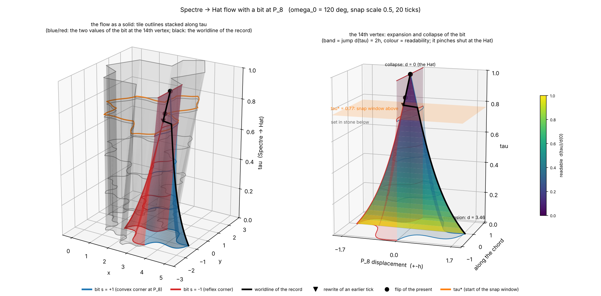
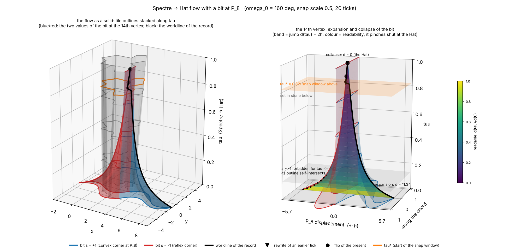
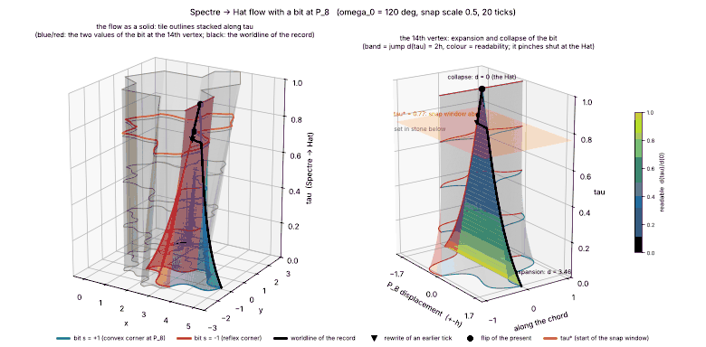
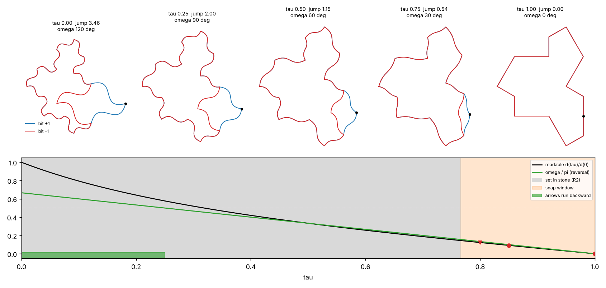
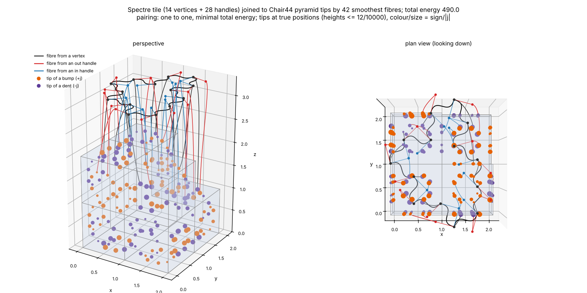
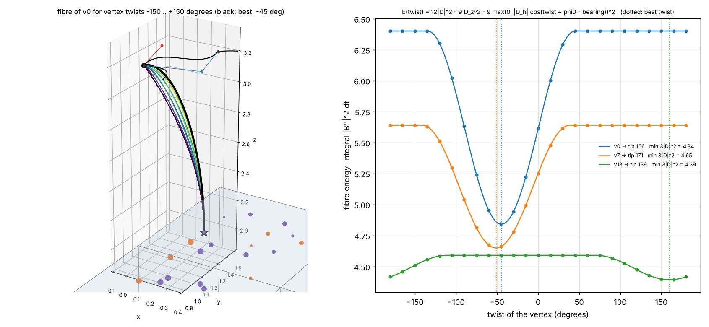

## spectre_hat_time_3d.png, spectre_hat_time_3d_omega160.png, spectre_hat_time_3d.gif

The figure of `spectre_hat_time_model.py` in three dimensions, `tau` vertical (made by `spectre_hat_time_3d.py`). Left: every outline of
the Spectre -> Hat flow stacked into a solid; grey is the smooth sector (every edge except 7 and 8), blue and red are edges 7 and 8 for
the two values of the bit at the 14th vertex (`s = +1` convex, `s = -1` reflex), black is the worldline of P_8 followed by the record
(triangle: rewrite of an earlier tick, circle: flip of the present), orange rings mark `tau*`, the start of the snap window. Right:
the 14th vertex alone in the frame of the flat vertex: a horn whose width is the jump `d(tau) = 2h`, coloured by readability
`d(tau)/d(0)`, widest at the Spectre (expansion) and pinched shut at the Hat (collapse); the orange plane is `tau*`. The `_omega160`
version (`omega_0 = 160` degrees) shows the stretch `tau <= 0.13` where the reflex outline self-intersects (dotted black), so the bit is
forced to `+1`. The GIF is a turntable of the first figure. Toy model, not a derivation; see `ARROW_OF_TIME.md`.

```
python3 spectre_hat_time_3d.py --no-show --save figures/spectre_hat_time_3d.png
python3 spectre_hat_time_3d.py --no-show --corner 160 --save figures/spectre_hat_time_3d_omega160.png
python3 spectre_hat_time_3d.py --no-show --gif figures/spectre_hat_time_3d.gif
```







## spectre_hat_time.png

Time, two arrows and one stored bit at the 14th vertex of the Spectre -> Hat flow. Top: the tile at `tau` = 0, 0.25, 0.5,
0.75, 1 with both values of the bit (blue `s = +1`, red `s = -1`; they differ only in edges 7 and 8 and coincide at the Hat).
Bottom: readability `d(tau)/d(0)` (black), the turn of the two arrows `omega/pi` (green), the ticks frozen by the cost rule
(grey), the window in which a snap is still allowed (orange), and the snaps of the scripted story. Toy model, not a derivation;
see `ARROW_OF_TIME.md`.

```
python3 spectre_hat_time_model.py --corner 120 --snap-scale 0.5 --no-show --save figures/spectre_hat_time.png
```








