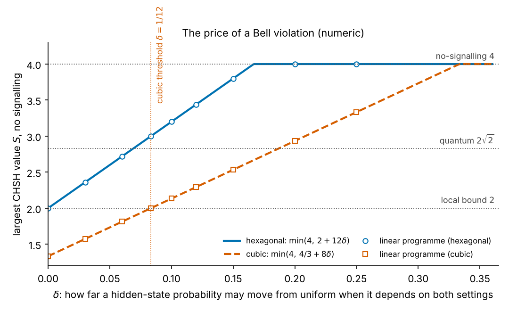
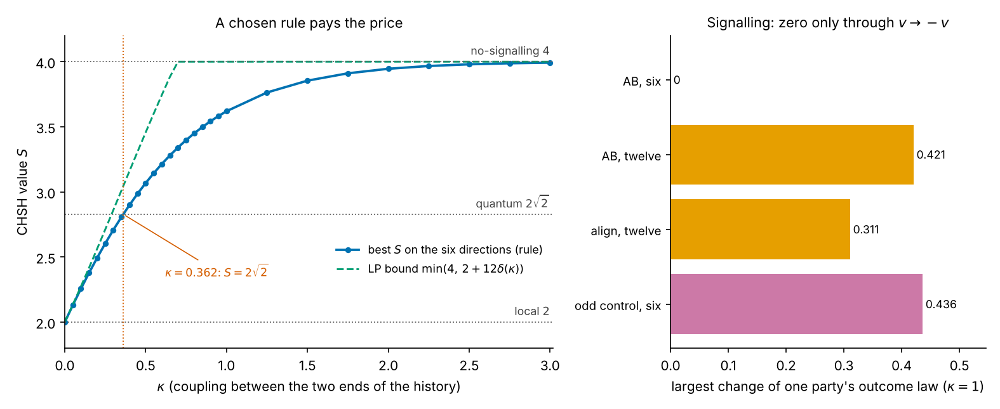
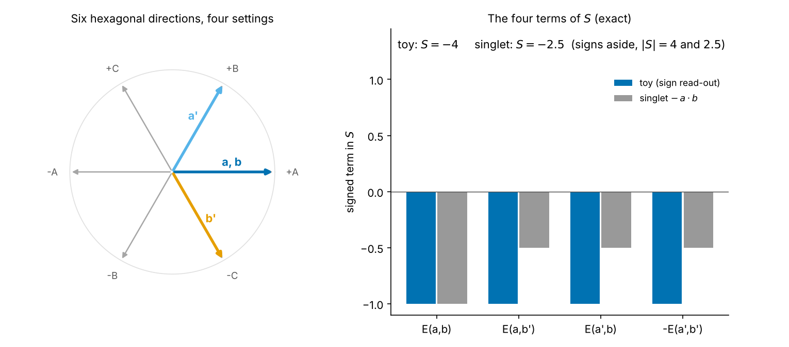
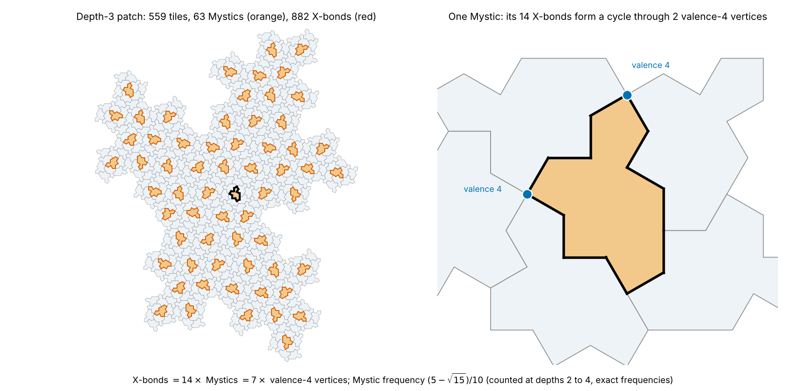
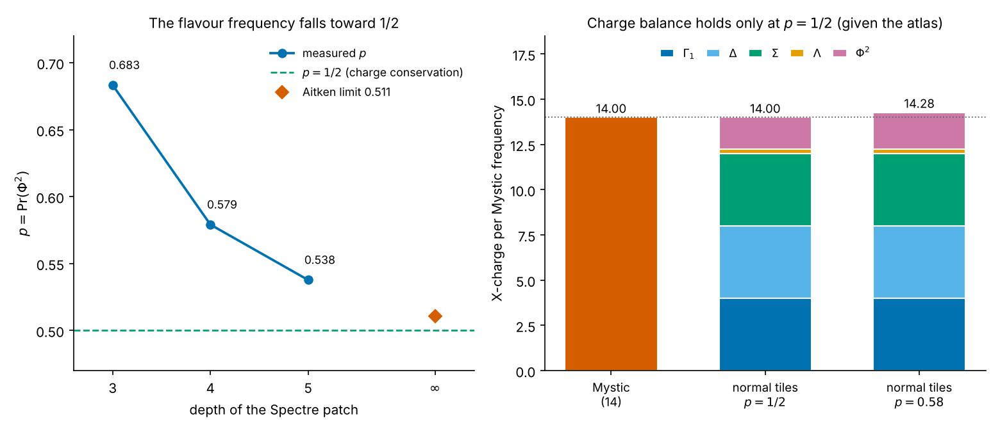

# Figures for the CHSH, retro-rule and Mystic results

Five matplotlib figures for results of `quantgrav.tex` (Results `chsh`, `price`, `rule`, `mystic`). They are **not** included in the paper; this page holds them with
the script that draws each, the numbers it checks, and the label of each statement. Every script recomputes its numbers and runs self tests; a figure is not
drawn if a test fails.

    python3 models/fig_chsh_price.py   --no-show --save-dir figures     (about 55 s: solves the linear programmes)
    python3 models/fig_retro_rule.py   --no-show --save-dir figures     (about 7 s)
    python3 models/fig_hex_settings.py --no-show --save-dir figures     (closed form)
    python3 models/fig_mystic_cycle.py --no-show --save-dir figures     (about 7 s)
    python3 models/fig_p_half.py       --no-show --save-dir figures     (about 8 s)
    add --tests-only to run only the checks

`fig_chsh_price.py` and `fig_retro_rule.py` import the `directional/` modules of the Quantum-Gravity-Dynamics fork (imported, not copied) through
`models/_qgd.py`, which looks in `$QGD_DIR`, then `../Quantum-Gravity-Dynamics`, then `/home/claude/Quantum-Gravity-Dynamics`. `fig_mystic_cycle.py` and `fig_p_half.py` import the
Hat and Spectre repository (`spectre_mystic_xbond.py`, `spectreatlas.py`) through `models/_spectre.py` (`$SPECTRE_DIR`, then `../spectre`, then `/home/claude/spectre`). `fig_hex_settings.py` needs nothing else.

## 1. The price of a Bell violation: `figures/chsh_price.png` (numeric)

Largest CHSH value S under no signalling against delta, how far a hidden-state probability may move from uniform when it depends on both settings. Hexagonal
set: min(4, 2 + 12 delta). Cubic set: min(4, 4/3 + 8 delta), which passes the local value 2 only for delta > 1/12 because the cubic read-out has zero outcomes.
The open markers are linear programmes solved by the fork (`hex_directions.scan_hex`, six read-outs; `retro_boundary_model.scan`, 26 cubic read-outs) and agree
with the lines to 1e-15. Tests: 6.

## 2. The rule that pays the price: `figures/retro_rule.png` (exact checks, numeric curve)

Left: best |S| on the six hexagonal directions for the weight P(v | a, b) proportional to exp(kappa A B): 2 at kappa = 0, 3.62 at kappa = 1, 2 sqrt 2 at
kappa = 0.362, always below the linear-programme bound min(4, 2 + 12 delta(kappa)). Right: signalling at kappa = 1. It is zero on the six directions and nonzero
for the twelve read-outs and for a control that breaks the symmetry v -> -v. So the zero is a symmetry property of the six, not a feature of the rule, and the
weight is a chosen family, not derived from a path action. Above 2 sqrt 2 the table is a no-signalling box, not a quantum model. Tests: 8.

## 3. Four settings on six hexagonal directions: `figures/hex_settings.png` (exact)

Settings a = b = +A, a' = +B, b' = -C give |S| = 4 for the toy with the sign read-out E(a, b) = -sgn(a . b); the singlet, E = -a . b, gives 5/2 on the same
settings (its maximum on the six). On the six cubic directions both give 2. The toy is a no-signalling table, not a model of the singlet. Tests: 4.

## 4. X-bonds are Mystic cycles: `figures/mystic_cycle.png` (counted)

Left: a depth-3 patch of the Spectre tiling (559 tiles) with the 63 Mystic tiles shaded and the 882 X-bonds in red. An X-bond is a shared edge on which the two tiles
disagree about the edge type. Right: one interior Mystic. Its 14 edges are all X-bonds, they form one cycle, and the cycle passes through exactly two interior
vertices of valence 4. Counted at this depth: a shared edge is an X-bond exactly when one of its tiles is the Mystic, no two Mystics share an edge, X-bonds = 14 M =
7 x (valence-4 vertices). The repository's own snapshot covers depths 2 to 4 and nine seeds. Tests: 5.

## 5. The flavour frequency p = 1/2: `figures/p_half.png` (exact given the atlas; measured values counted)

Left: the measured p = Pr(Phi^2) at depths 3, 4, 5 (0.683, 0.579, 0.538), falling toward 1/2, with the Aitken extrapolation 0.511. Right: X-charge per Mystic
frequency. The Mystic carries 14; the normal tiles carry 4 (one each of Gamma_1, Delta, Sigma), 2 (Lambda) and 2 p (Phi); with the exact Perron frequencies the stack equals 14
only at p = 1/2 and is 14.28 at p = 0.58. The balance is exact **given the counted atlas of per-species charges**, which is not derived. Tests: 5.

## What these figures do not show

They show properties of a chosen toy and of linear programmes over it. No measured CHSH value is used, no claim is made about gravity, and the rule of figure 2
is not derived. Figures 4 and 5 show a finite patch and a conservation law that holds given the atlas; they do not prove the atlas or the Mystic statement at every depth.
