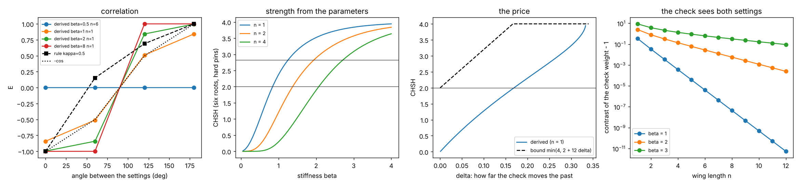
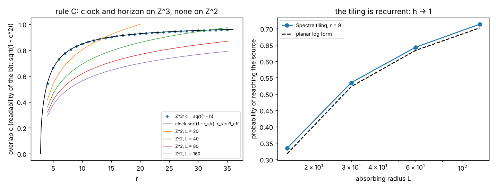
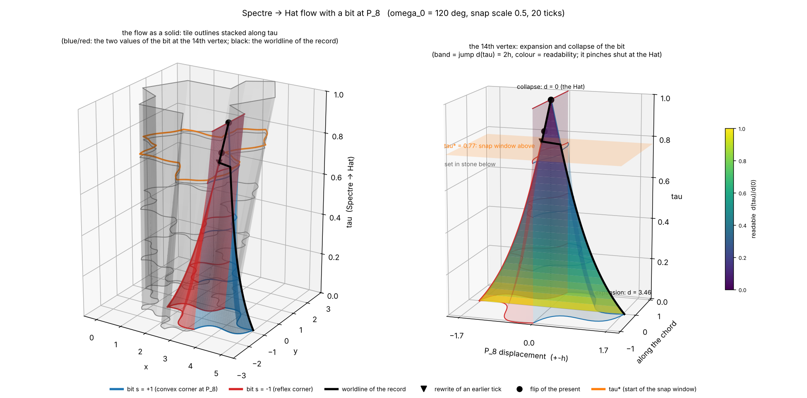
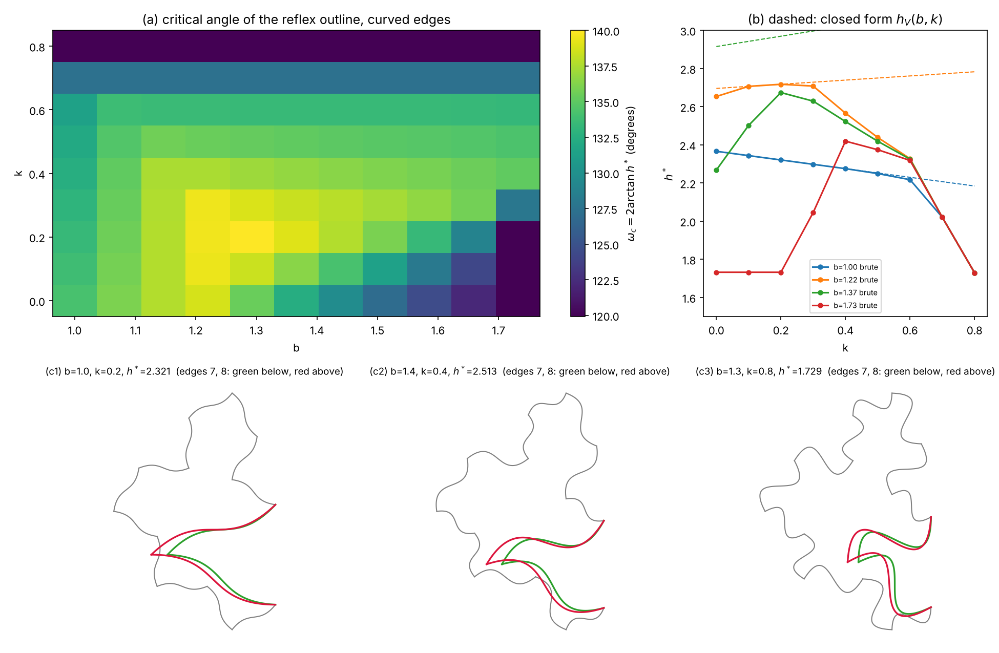
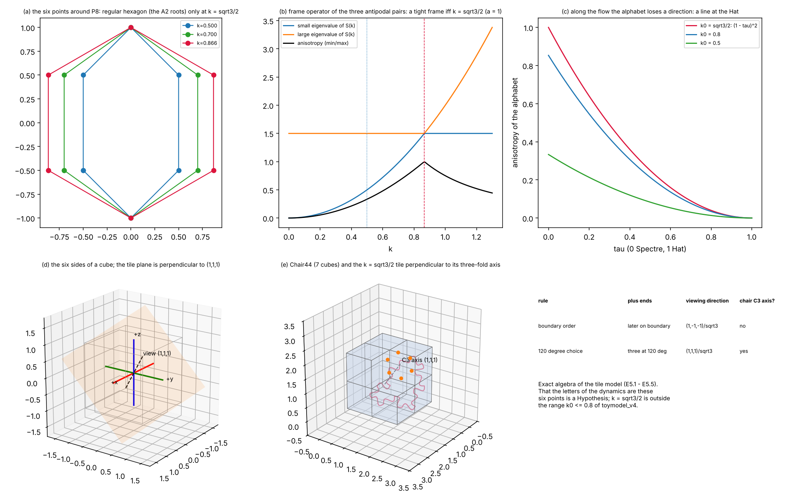
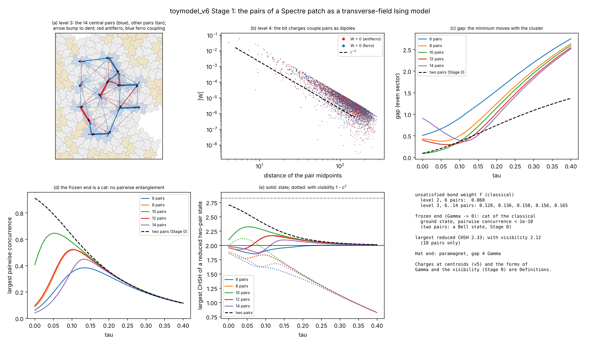
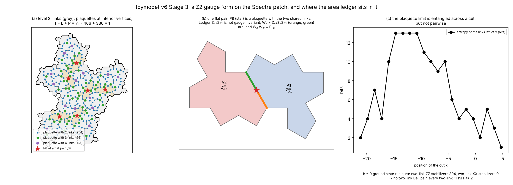
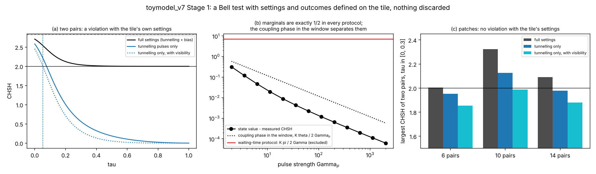
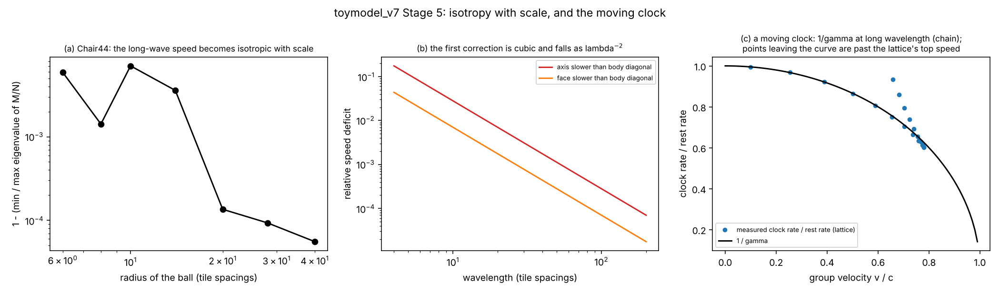
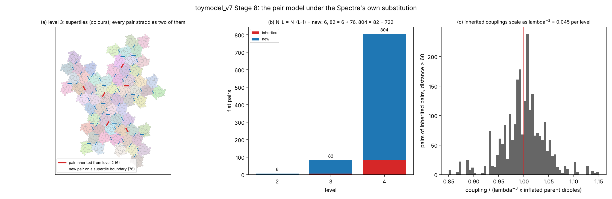

# The toy models: what we built, what worked, and what did not

This folder holds seven toy models, `toymodel_v1` to `toymodel_v7`, built one after another to test a single idea: that an aperiodic tile, the Spectre, deformed into its cousin the Hat, might carry structure that a theory of time, quantum correlations and gravity could later be written on. Each model was written to answer the questions the previous one left open. Every result is a computation with a test that can fail, and most of them are negative. This page is a guided tour for a reader who has not followed the work: what each model is, which results are new or unusual, what did and did not work, and where to read more.

The paper that collects the results is [`quantgrav.tex`](../quantgrav.tex) (built with `make quantgrav`). Every number in it is recomputed from the code here by [`models/paper_numbers.py`](../models/paper_numbers.py).

**A word on labels.** Results are marked **Exact** (a proof, or exact arithmetic on a finite object), **Numeric** (a computation with a stated tolerance), **Definition** (a choice we made), **Hypothesis** (a guess that nothing here tests) or **Negative** (something we hoped for that failed). None of this is a derivation of physics. The words "clock", "light", "gravity" and "entanglement" are borrowed, and each model says exactly what it means by them.

## Contents

1. [The foundations in brief](#1-the-foundations-in-brief)
2. [The models one by one](#2-the-models-one-by-one)
3. [What is unusual about this approach](#3-what-is-unusual-about-this-approach)
4. [What worked](#4-what-worked)
5. [What did not work](#5-what-did-not-work)
6. [Where things stand](#6-where-things-stand)
7. [Running the code](#7-running-the-code)
8. [References](#8-references)

## 1. The foundations in brief

These are the ideas the models rest on. Each has a Wikipedia link for a gentle introduction.

**Aperiodic tilings and the einstein.** A tiling is [aperiodic](https://en.wikipedia.org/wiki/Aperiodic_tiling) if it covers the plane but never repeats, like the [Penrose tiling](https://en.wikipedia.org/wiki/Penrose_tiling). The [einstein problem](https://en.wikipedia.org/wiki/Einstein_problem) asked whether a single shape can do this on its own. In 2023 Smith, Myers, Kaplan and Goodman-Strauss found the *Hat* [SMKG24] and then the *Spectre* [SMKG23], a shape that tiles only aperiodically and only in one handedness (it is *strictly chiral*). The Hat and the Spectre are members of one family of polygons with two edge lengths, so one can be deformed into the other. Aperiodic tilings are the mathematics of [quasicrystals](https://en.wikipedia.org/wiki/Quasicrystal) [Baake13].

**The 14th vertex and its bit.** The Spectre has 14 corners; one of them (called P₈ here) lies on a straight line in the straight-edged version. Along the deformation from Spectre to Hat that corner can stand out of the line (convex) or into it (reflex). That two-valued choice is the *bit* that every model since v4 is built on. The two values differ in area by exactly the jump of the corner, and the jump closes at the Hat.

**Lifts and lattices.** The Spectre's edges point in twelve directions, so its corners can be lifted to a four-dimensional lattice built from two copies of the [Eisenstein integers](https://en.wikipedia.org/wiki/Eisenstein_integer) [Chéritat23]. The paper shows that this lift sits inside the [E₈ lattice](https://en.wikipedia.org/wiki/E8_lattice) with every edge a root of [E₈](https://en.wikipedia.org/wiki/E8_(mathematics)). E₈ also has an older connection to quasicrystals through the [icosians](https://en.wikipedia.org/wiki/Icosian) and the [golden ratio](https://en.wikipedia.org/wiki/Golden_ratio) [ElserSloane87, SadocMosseri93], and through the [Hopf fibration](https://en.wikipedia.org/wiki/Hopf_fibration), which organises the [24-cells](https://en.wikipedia.org/wiki/24-cell) inside the [600-cell](https://en.wikipedia.org/wiki/600-cell). The Spectre's inflation factor is tied to a [Pisot number](https://en.wikipedia.org/wiki/Pisot%E2%80%93Vijayaraghavan_number), which is why its patches smooth out quickly at large scale [BGMS24].

**The Chair44.** A three-dimensional aperiodic monotile, the Chair44 [Tsiokos26, Flicker26], whose decorated faces carry 192 pyramid tips. 192 is also the number of "equatorial" roots of E₈, and several models test whether that is more than a coincidence.

**Bell tests and the CHSH number.** [Bell's theorem](https://en.wikipedia.org/wiki/Bell%27s_theorem) says that correlations explained by a shared past obey a bound. In the [CHSH form](https://en.wikipedia.org/wiki/CHSH_inequality) [Bell64, CHSH69] a number S built from four correlations satisfies |S| ≤ 2 for any shared past, quantum mechanics reaches 2√2 ([Tsirelson's bound](https://en.wikipedia.org/wiki/Tsirelson%27s_bound) [Cirelson80]), and tables that merely forbid signalling can reach 4 [PopescuRohrlich94]. Exceeding 2 needs the past to depend on the settings, a relaxation of measurement independence [Hall10], or a [loophole](https://en.wikipedia.org/wiki/Loopholes_in_Bell_tests) such as discarding runs [Pearle70]. The dynamic models borrow ideas from retrocausal readings of quantum mechanics: the [two-state vector formalism](https://en.wikipedia.org/wiki/Two-state_vector_formalism) [ABL, Aharonov02] and the [transactional interpretation](https://en.wikipedia.org/wiki/Transactional_interpretation) [Cramer86, Kastner12].

**Gravity in a toy.** In general relativity a clock deep in a gravitational well runs slow ([gravitational time dilation](https://en.wikipedia.org/wiki/Gravitational_time_dilation)), light is bent by twice the amount a clock alone would give ([gravitational lensing](https://en.wikipedia.org/wiki/Gravitational_lens)), signals are delayed ([Shapiro delay](https://en.wikipedia.org/wiki/Shapiro_time_delay)), and the [Schwarzschild metric](https://en.wikipedia.org/wiki/Schwarzschild_metric) has an [event horizon](https://en.wikipedia.org/wiki/Event_horizon) where the clock stops. The toy models try to reproduce these as statements about the bit, and keep score of which ones they reach.

**Quantum many-body tools.** v6 and v7 use a [transverse-field Ising model](https://en.wikipedia.org/wiki/Transverse-field_Ising_model) for the bits, measure entanglement with the [concurrence](https://en.wikipedia.org/wiki/Concurrence_(quantum_computing)) [Wootters98] and the [entanglement entropy](https://en.wikipedia.org/wiki/Entropy_of_entanglement), and use a [Z₂ lattice gauge theory](https://en.wikipedia.org/wiki/Lattice_gauge_theory) with its [Kramers–Wannier](https://en.wikipedia.org/wiki/Kramers%E2%80%93Wannier_duality) (Wegner) duality. A local Hamiltonian is a quantum version of a constraint problem [Gharibian15]. Causality in such systems is the [Lieb–Robinson bound](https://en.wikipedia.org/wiki/Lieb%E2%80%93Robinson_bounds). A particle that has to drag a slow environment along moves more slowly: the [polaron](https://en.wikipedia.org/wiki/Polaron) effect, through the [Franck–Condon](https://en.wikipedia.org/wiki/Franck%E2%80%93Condon_principle) overlap.

**Time's arrow.** The laws we use are time-reversal symmetric ([T-symmetry](https://en.wikipedia.org/wiki/T-symmetry)), yet the world has an [arrow of time](https://en.wikipedia.org/wiki/Arrow_of_time). Barbour and collaborators study arrows that point away from a special central moment, the "Janus point" [BarbourLobo26, BarbourLourenço26]; the models test which of our structures, if any, supplies an arrow on its own.

## 2. The models one by one

| model | question | main finding |
|---|---|---|
| v1 | the original dynamic proposal: timelines of six directions, contracts between particles, a density that slows clocks, a wave on a grid | a working simulation of the proposal, with nothing yet tested against a bound |
| v2 | can the proposal be made exact and audited? | a correlation rule follows from a history conditioned at both ends; every arrow of time is put in by hand |
| v3 | the problems v2 left: light bending, a 1/r clock, the arrow, the post-selection | a clock alone bends light by half; a three-dimensional substrate gives 1/r and a horizon; v2's Bell violation was the detection loophole |
| v4 | use the tile's actual outline, not an abstract chain | only bump-and-dent *pairs* of tiles can carry a bit; the critical angle for the reflex value |
| v5 | combine several tiles with the Chair44 | the six points the bit moves are the shadow of a cube; the Chair44 read as a source is neutral; no clock from the chair alone |
| v6 | give the bits a quantum Hamiltonian | each pair is one qubit; on a patch the pairs are frustrated dipoles; a gauge form puts the bit at a vertex as a flux; a polaron clock |
| v7 | turn every missing feature into a test | a scoreboard; a Bell test with the tile's own settings; E₈ carries both number fields; a light cone at long wavelength; a renormalisation map that closes |

### toymodel_v1: the proposal as code

Four scripts (`AxisNetwork.py`, `CoupledParticleNetwork.py`, `GravitationalTimelineNetwork.py`, `GridWaveSimulator.py`) implement the paper's original dynamic picture: a particle's history is a timeline of steps along six directions (±X, ±Y, ±Z); two particles share a "contract" that ties their outcomes; a density field slows the local clock; a wave equation on a grid carries the density. It is a simulation, not yet a test. v2 audits it (`toymodel_v2/audit_v1.py`).

### toymodel_v2: an exact audit (`toymodel_v2/`, Stages 0 to 5)

v2 rebuilds the proposal as exact computations on hexagonal histories and tests every claim.

- The deformation from Spectre to Hat is one integer walk in the lift lattice; the tiling's bonds never change, only the scale of the two planes. Opening the bit on every tile breaks the tiling; it closes only on pairs of tiles that open as a bump and a dent (Stage 0).
- With a global flux constraint, a measurement acts on a whole history at once, not as a fading ripple (Stage 1).
- **The arrow audit** (Stage 3): every orientation in the proposal is an input. The base point of the flux, a pinned end, the sign of the damping and the orientation of the flow each carry an arrow; handedness and scale ordering do not. Records sit at the end the flow runs *away from*.
- **A rule from a two-ended history** (Stage 4): conditioning a history at both ends gives a correlation rule with no free parameter that violates CHSH, but nothing bounds it at 2√2.



- **Waves** (Stage 5): with the paper's wave equation, waves run *faster* where the density is higher, the opposite of what a gravitational analogy needs. A 1/r profile needs three dimensions.

### toymodel_v3: the problems of the first pass (`toymodel_v3/`)

- **Light bending** needs a space factor: written as a refractive index, a clock alone bends light by r_s/b, half of general relativity's 2r_s/b (`t3_optics.py`).
- **A clock from escape**: if the bit's overlap is set by the chance that a random walk on the substrate reaches the source, the cubic lattice gives the clock factor √(1 − r_s/r), a 1/r profile and a horizon in one rule. The Spectre's own graph is two-dimensional, so the walk always returns and gives none of them (`t3_escape.py`) [DoyleSnell84].



- **The arrow**: a signed-area term is odd under time reversal and under a mirror, so a mirror world carries the opposite arrow; an external record store makes "determined", "recorded" and "hard to change" agree (`t3_area.py`, `t3_records.py`).
- **The Bell violation was a loophole**: with a constant acceptance rate the violation stays, but the Clauser–Horne combination [ClauserHorne74], which counts rejected runs, never fails. Read as data, the two-ended tables are local with the detection loophole (`t3_passrate.py`). Made coherent with a sign that the toy does not supply, the shared origin gives the singlet state exactly (`t3_qubit.py`).

### toymodel_v4: the tile's own outline (`toymodel_v4/`)

v4 works with the actual curved outline of the tile.



- The reflex value of the bit is a valid tile only below a **critical angle**, with a closed form for straight edges (134.2° for the straight Spectre) and a more intricate one for curved edges.



- On a patch only tiles in bump-and-dent pairs can open, about 22.5% of tiles in the limit, and the pairs are geometrically independent. The pair counts obey an exact linear recurrence.
- The outline has a canonical spin structure, but it does not supply the relative sign the singlet needs; the entropy of the bits falls along the flow instead of rising (**Negative**).

### toymodel_v5: several tiles and the Chair44 (`toymodel_v5/`)

v5 sets tiles against the Chair44's 192 tips, using the count 192 = 3·42 + 3·14 + 4·6 (three curved tiles, three straight tiles, four groups of six points).



- The six points the bit moves form a regular hexagon, a [tight frame](https://en.wikipedia.org/wiki/Frame_(linear_algebra)) [BenedettoFickus03] and the orthographic shadow of a cube's six sides at one and the same curvature, seen along the chair's own three-fold axis (**Exact**).
- On those six points the two-ended rule of v2 violates CHSH with a strength set by the curvature; the cube's own six directions never do.
- The Chair44 read as a set of charges is neutral to two orders, with a saddle-shaped [quadrupole](https://en.wikipedia.org/wiki/Multipole_expansion) [Jackson98]; one reflection of the chair acts as charge conjugation. So the chair alone gives no clock (**Negative**).

### toymodel_v6: a quantum Hamiltonian (`toymodel_v6/`)

- **The pair qubit.** With the tiling's area ledger as a constraint, the Ising coupling inside a pair becomes the tunnelling of one qubit, exactly and for any strength of the constraint. The unit of quantum information is the pair, not the tile.
- **A patch.** Reading the bits as charges makes each pair a dipole; the couplings fall as r⁻³, come with both signs, and the patch is [frustrated](https://en.wikipedia.org/wiki/Geometrical_frustration). At the frozen (Spectre) end the ground state is a [GHZ-like](https://en.wikipedia.org/wiki/Greenberger%E2%80%93Horne%E2%80%93Zeilinger_state) cat with no pairwise entanglement; entanglement peaks in the middle of the flow.



- **Hopping.** A particle on the Spectre graph spreads isotropically but sub-ballistically (as t^0.56); on the Chair44 it is cubic, slowest along the cube axes, opposite to what the hop count predicts.
- **A gauge form.** Tiles, shared edges and vertices make a disc; a Z₂ gauge theory on it is consistent and dual to an Ising model on the vertices. The area ledger is not its Gauss law: it sits in the theory as the *flux* through the vertex the pair shares. The plaquette limit is entangled but has no two-link Bell pair.



- **A clock.** A particle that has to switch fast bits as it hops carries their overlap per hop (the Franck–Condon factor). With the bit on the seam, its rate is the overlap c, which is the clock factor to first order.

### toymodel_v7: the missing features as tests (`toymodel_v7/`)

v7 turns the list of missing features into a scoreboard (`t7_targets.py`) and works through it. Its own summary is in [`toymodel_v7/README.md`](toymodel_v7/README.md).



- **A Bell test without post-selection.** A setting is a brief pulse of the pair's own tunnelling, the outcome is which tile is the bump, and no run is discarded. Two pairs violate CHSH (2.45 with the read-out visibility). Every marginal is exactly ½, so locality is decided by how long the coupling acts during the measurement, not by marginals. On patch clusters the violation disappears (**Negative**).
- **Number fields.** E₈'s [Coxeter element](https://en.wikipedia.org/wiki/Coxeter_element) of order 30 carries the Eisenstein (√−3) and the golden (√5) structures at once. The Spectre's inflation λ is not in that field, but λ√2 = √3 + √5 exactly, so λ² = 4 + √3·√5 is built from the two.
- **The layout.** Under rules fixed in advance, the chair's three-fold axis selects one decomposition of 192 out of 126: twelve Hat tiles and six groups of the 14th vertex's points, one per side of the cube. It is not the one v5 used, and it is neutral.
- **Space factor and horizon.** The bit lengthens its own edges as 1/c, the opposite of what doubling the bending of light needs. Under the field rule of v2, Gauss's law keeps the field finite at every radius, so the bits cannot make a horizon; and the critical angle puts a floor of 0.0609 on the overlap any tile can represent (**Negative**).
- **Lorentz.** A wave that is second order in time has an isotropic light cone on the Chair44 at long wavelength (to 6·10⁻⁵), with corrections falling as (tile size / wavelength)². A moving clock built from it runs slow by the [Lorentz factor](https://en.wikipedia.org/wiki/Lorentz_factor) γ. The quantum hopping of v6 is the non-relativistic (Galilean) form.



- **The arrow.** Every Hamiltonian the models built is real, so time-reversal even, and the Spectre's handedness is a parity, not a time reversal. Starting from the frozen state, entanglement grows, and it grows identically into the past and the future: an arrow set by the initial state, pointing away from it both ways.
- **Renormalisation.** No bump-and-dent pair lies inside a supertile; every pair of one level reappears as exactly one pair of the next, and new pairs appear on supertile boundaries by a local rule. The inherited couplings fall as λ⁻³ per level, so the [renormalisation](https://en.wikipedia.org/wiki/Renormalization_group) map closes, with a trivial fixed point for the inherited pairs.



## 3. What is unusual about this approach

- **The physics sits on one corner of one tile.** Almost everything from v4 on is about a single two-valued choice: whether one corner of the Spectre stands out or in. That choice has an exact area, an exact validity limit, an exact pairing rule on a tiling and an exact inheritance under substitution. Few toy models of quantum gravity start from an object this small and this rigid.
- **The geometry decides, not a fit.** The couplings between bits come from reading them as charges on real tile positions, not from a chosen kernel; the layout of the Chair44 comes from rules written down before counting; the renormalisation blocks are the tiling's own supertiles.
- **Negative results are deliverables.** Each model has stop conditions written in advance, and many stages end in a **Negative**: the bending factor, the horizon, the monopole, the arrow. The failures are as precise as the successes, and they narrow what a theory on these structures could be.
- **Every number is reproducible.** Each module runs its own tests (`--tests-only`), and every number quoted in the paper is recomputed from the code.
- **One family connects two worlds.** The deformation from Spectre to Hat runs from a strictly chiral tile with readable bits (the "frozen" end) to a tile where the bit vanishes (the "plastic" end). The same parameter controls the area of the bit, the readability of the bit, its tunnelling, the strength of its correlations and the rate of its clock.

## 4. What worked

| result | where | label |
|---|---|---|
| The Spectre's lift lattice sits in E₈ with every edge a root, for the whole Spectre–Hat family | paper, Section on E₈ | Exact |
| Only bump-and-dent pairs can open on a tiling; their counts obey an exact recurrence | v2 Stage 0, v4 | Exact |
| The six points around the bit are the shadow of a cube along the chair's axis, at one curvature | v5 Stage 0 | Exact |
| Inside a pair, the Ising coupling is exactly a tunnelling term of one qubit | v6 Stage 0 | Exact |
| A Bell test with the tile's own settings and nothing discarded, for two pairs (CHSH 2.45 with visibility) | v7 Stage 1 | Exact, given v6's definitions |
| The overlap of the bit is the rate of a clock (Franck–Condon), and with seam bits it is the clock factor to first order | v6 Stage 4 | Numeric, Exact algebra |
| E₈ carries the Eisenstein and golden structures through one Coxeter element; λ² = 4 + √3·√5 | v7 Stage 2 | Exact |
| An isotropic light cone at long wavelength on the Chair44, and time dilation by γ | v7 Stage 5 | Exact sums |
| Entropy that grows in a unitary dynamics from the frozen state, with the records kept at the frozen end | v7 Stage 7 | Numeric |
| The pair model closes under the Spectre's substitution | v7 Stage 8 | Exact |

## 5. What did not work

| hoped for | what happened | where |
|---|---|---|
| A single arrow of time from the structures | every orientation is put in by hand; the tile supplies no time-odd term; the arrow comes from the initial state | v2 Stage 3, v7 Stage 7 |
| A quantum bound (Tsirelson) from the rule | the two-ended rule exceeds 2√2; in a Hamiltonian the bound is automatic and says nothing about the model | v2, v6 |
| A Bell violation that is not a loophole | v2's violation was the detection loophole; the tile-settings test of v7 works for two pairs only, not on a patch | v3, v7 Stage 1 |
| Light bent by twice the clock value | a clock alone gives half; the tile's own geometry pushes the other way | v3, v7 Stage 4 |
| A horizon | impossible under the field rule (Gauss), and the critical angle puts a floor on the overlap | v7 Stage 6 |
| A 1/r field from the Chair44 | the chair is neutral to two orders; the layout the rules select has no monopole | v5, v7 Stage 3 |
| Chair44 ↔ E₈ beyond the count 192 | the shapes match, the structures do not | paper, Section on the Chair44 |
| Waves slowed by density | the paper's equation makes them faster; written as an index they slow, but no reason for that form | v2, v3 |
| An entropy that rises along the deformation | the counting entropy of the bits falls toward the Hat | v4 |
| Ballistic transport on the Spectre | a quantum particle spreads as t^0.56 | v6 Stage 2 |

## 6. Where things stand

The quantum side and the relativity side have moved forward: the bit gives a qubit, a clock, a Bell test without discarded runs, a light cone at long wavelength, a growing entropy and a renormalisation map that closes. The algebra has found one lattice for the two number fields of the paper. The gravity side has not: the factor 2 of light bending, the horizon and a 1/r source are all still open, and each of the last two models has made the reason more specific. The scoreboard in `toymodel_v7/t7_targets.py` lists every gap as a number, and the next model starts there.

## 7. Running the code

All commands run from the repository root with `numpy`, `scipy`, `sympy` and `matplotlib`. Each module has a self test:

```
python3 research/toymodel_v2/tm2_rule.py --tests-only
python3 research/toymodel_v6/t6_patch.py --tests-only
python3 research/toymodel_v7/t7_targets.py             # the v7 scoreboard
make quantgrav                                         # numbers + the paper
```

Each folder's `PLAN.md` says what the model set out to do and in what order, and its `STAGE*.md` files give every result with its label. The later models import from the earlier ones (v6 from v3 and v4, v7 from v3, v4 and v6) and from `models/`, so keep the folder layout.

## 8. References

These are cited above; the full list with notes on what was read is in [`quantgrav.bib`](../quantgrav.bib).

- [SMKG24] D. Smith, J. S. Myers, C. S. Kaplan, C. Goodman-Strauss, *An aperiodic monotile*, Combinatorial Theory 4(1) (2024), [arXiv:2303.10798](https://arxiv.org/abs/2303.10798).
- [SMKG23] D. Smith, J. S. Myers, C. S. Kaplan, C. Goodman-Strauss, *A chiral aperiodic monotile* (2023), [arXiv:2305.17743](https://arxiv.org/abs/2305.17743).
- [Chéritat23] A. Chéritat (with N. Ma), *4D lift of the tilings by the Smith et al. aperiodic monotile*, [web page](https://www.math.univ-toulouse.fr/~cheritat/2023-monotile/4D-lift/).
- [BGMS24] M. Baake, F. Gähler, J. Mazáč, L. Sadun, *On the long-range order of the Spectre tilings* (2024), [arXiv:2411.15503](https://arxiv.org/abs/2411.15503).
- [Baake13] M. Baake, U. Grimm, *Aperiodic Order, Vol. 1: A Mathematical Invitation*, Cambridge University Press (2013).
- [Tsiokos26] I. Tsiokos, *A Strongly Aperiodic Monotile in Three Dimensions* (2026), [arXiv:2609.19214](https://arxiv.org/abs/2609.19214).
- [Flicker26] F. Flicker, *Matching Rules for a Three-Dimensional Strongly Aperiodic Monotile* (2026), [arXiv:2609.23783](https://arxiv.org/abs/2609.23783).
- [ElserSloane87] V. Elser, N. J. A. Sloane, *A highly symmetric four-dimensional quasicrystal*, J. Phys. A 20 (1987) 6161.
- [SadocMosseri93] J. F. Sadoc, R. Mosseri, *The E8 lattice and quasicrystals*, J. Non-Cryst. Solids 153–154 (1993) 247.
- [Bell64] J. S. Bell, *On the Einstein Podolsky Rosen paradox*, Physics 1 (1964) 195.
- [CHSH69] J. F. Clauser, M. A. Horne, A. Shimony, R. A. Holt, *Proposed experiment to test local hidden-variable theories*, Phys. Rev. Lett. 23 (1969) 880.
- [Cirelson80] B. S. Cirel'son, *Quantum generalizations of Bell's inequality*, Lett. Math. Phys. 4 (1980) 93.
- [PopescuRohrlich94] S. Popescu, D. Rohrlich, *Quantum nonlocality as an axiom*, Found. Phys. 24 (1994) 379.
- [Hall10] M. J. W. Hall, *Local deterministic model of singlet state correlations based on relaxing measurement independence*, Phys. Rev. Lett. 105 (2010) 250404, [arXiv:1007.5518](https://arxiv.org/abs/1007.5518).
- [Pearle70] P. M. Pearle, *Hidden-variable example based upon data rejection*, Phys. Rev. D 2 (1970) 1418.
- [ClauserHorne74] J. F. Clauser, M. A. Horne, *Experimental consequences of objective local theories*, Phys. Rev. D 10 (1974) 526.
- [ABL] Y. Aharonov, S. Popescu, J. Tollaksen, L. Vaidman, *Multiple-time states and multiple-time measurements in quantum mechanics* (2007).
- [Aharonov02] Y. Aharonov, L. Vaidman, *The two-state vector formalism: an updated review*, in *Time in Quantum Mechanics* (2002).
- [Cramer86] J. G. Cramer, *The transactional interpretation of quantum mechanics*, Rev. Mod. Phys. 58 (1986) 647.
- [Kastner12] R. E. Kastner, *The Transactional Interpretation of Quantum Mechanics: The Possibility of Possible Worlds*, Cambridge University Press (2012).
- [BarbourLobo26] J. Barbour, F. S. N. Lobo, M. I. R. Lourenço, *Structural morphology and the gravitational arrow of time* (2026), [arXiv:2607.27526](https://arxiv.org/abs/2607.27526).
- [BarbourLourenço26] J. Barbour, M. I. R. Lourenço, *A Scale-Invariant Theory of the Universe* (2026), [arXiv:2608.05929](https://arxiv.org/abs/2608.05929).
- [DoyleSnell84] P. G. Doyle, J. L. Snell, *Random Walks and Electric Networks*, MAA (1984).
- [BenedettoFickus03] J. J. Benedetto, M. Fickus, *Finite normalized tight frames*, Adv. Comput. Math. 18 (2003) 357.
- [Jackson98] J. D. Jackson, *Classical Electrodynamics*, 3rd ed., Wiley (1998).
- [Wootters98] W. K. Wootters, *Entanglement of formation of an arbitrary state of two qubits*, Phys. Rev. Lett. 80 (1998) 2245.
- [Gharibian15] S. Gharibian, Y. Huang, Z. Landau, S. W. Shin, *Quantum Hamiltonian Complexity*, Found. Trends Theor. Comput. Sci. 10 (2015) 159, [arXiv:1401.3916](https://arxiv.org/abs/1401.3916).
