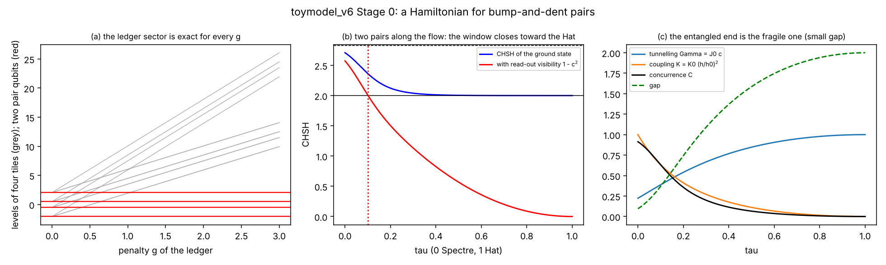

The unit of quantum information is the pair, not the tile. A Bell test needs two pairs, a coupling between them, and a second read-out of the pair qubit. The tile model does not supply that second read-out yet.

The direction agrees with v5 Stage 1. The violating window is at the Spectre end and closes toward the Hat, now bounded by 2√2.

The entangled end is the fragile one. The gap is 0.095 at the Spectre against 2 at the Hat.

The flow result depends on forms I chose: tunnelling Γ = J₀·c(τ) from the v2 overlap, coupling K ∝ h(τ)², visibility 1 − c², and J₀ = K₀ = σ = 1. Different forms would move the window; the first four rows of the table do not depend on them.
