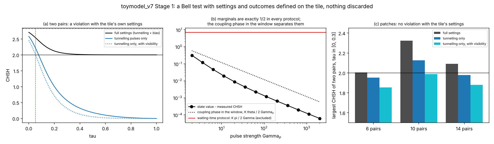
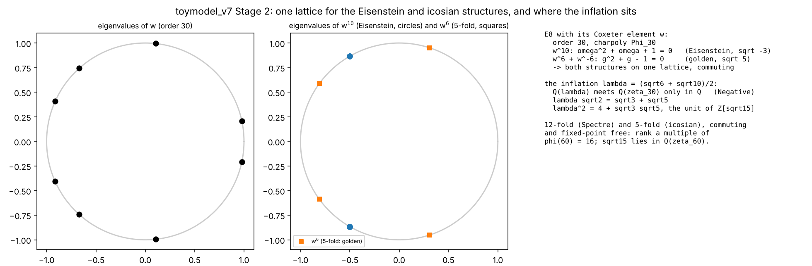
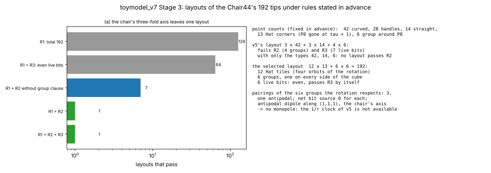
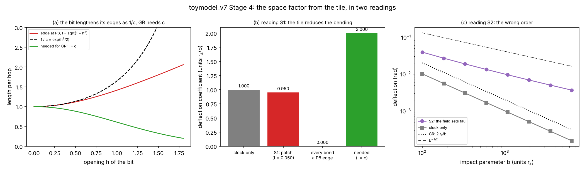
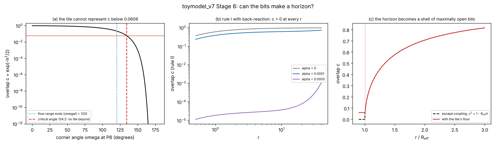
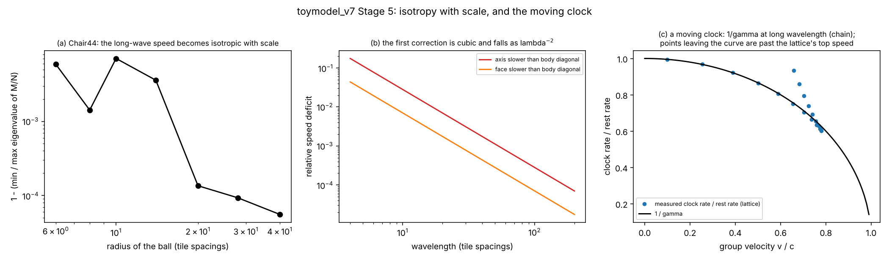
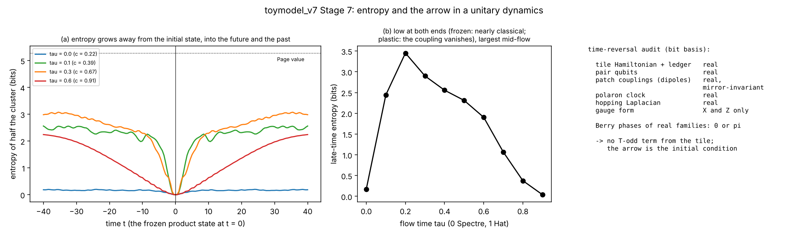
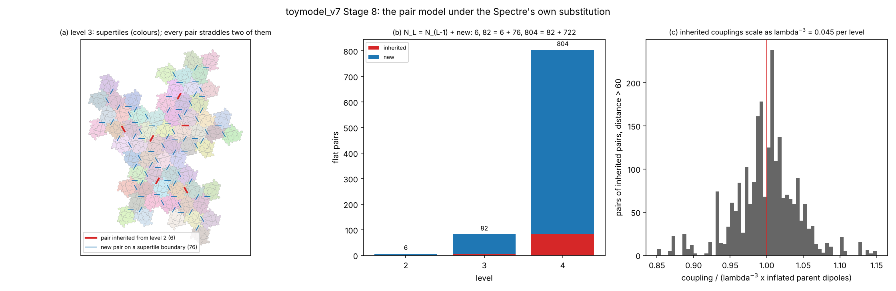

# toymodel_v7: turning the missing features into tests

This model takes the list of features the theory lacks (a space factor for light bending, a horizon, Lorentz invariance, a Bell test without post-selection, one structure for the number fields, a reason for the Chair44 layout, an entropy and an arrow, a renormalisation flow) and turns each one into a computation that can fail. Results are labelled **Exact**, **Numeric**, **Definition**, **Hypothesis** or **Negative**, as in `quantgrav.tex`. Nothing here is a derivation of physics: each result says what the tile model does, under definitions that are stated.

The plan is in `PLAN.md`, one results file per stage (`STAGE0.md` and on), one module per stage with `--tests-only`, and the figures in `figures/`. All nine stages (0 to 8) are done.

```
python3 research/toymodel_v7/t7_targets.py            # the scoreboard
python3 research/toymodel_v7/t7_<stage>.py --tests-only
```

## The scoreboard

`t7_targets.py` turns every gap into one number with a target. After all stages it reads:

| area | entry | value | target | status |
|---|---|---|---|---|
| gravity | light-bending coefficient (r_s / b) | 1.00 | 2 | open |
| gravity | the same with the tile's own space factor (field sets the opening) | 0.950 | 2 | open |
| gravity | fall-off of the bending when the field sets the flow time | b^-0.53 | b^-1 | open |
| gravity | seam clock against sqrt(1 - r_s/r) at 2 r_s | 10.1% | 0 | open |
| gravity | overlap at r = r_s (a horizon needs 0) | 0.607 | 0 | open |
| gravity | least overlap any tile can represent | 0.0609 | 0 | open |
| quantum | CHSH, two pairs, tile settings, read-out visibility, nothing discarded | 2.454 | > 2 | **met** |
| quantum | the same on patch clusters | 1.988 | > 2 | open |
| quantum | largest CHSH of any state | 2.828 | <= 2 sqrt2 | met (automatic) |
| algebra | E8 carries the Eisenstein and golden structures together | yes | yes | **met** |
| algebra | the inflation squared lies in Q(sqrt3, sqrt5) | yes | yes | **met** |
| algebra | quadratic subfields shared by the inflation field and Q(zeta_30) | 0 | >= 1 | open |
| algebra | least rank carrying the 12-fold and 5-fold rotations together | 16 | 8 | open |
| layout | layouts of the 192 tips passing rules stated in advance | 1 | exactly 1 | **met** |
| layout | net source of that layout (a 1/r field needs one) | 0 | != 0 | open |
| relativity | long-wave cone anisotropy on the Chair44 | 5.6e-5 | < 1e-3 | **met** |
| relativity | moving clock against 1/gamma at long wavelength | 3e-4 | < 1e-3 | **met** |
| relativity | fourth-moment index of a packet started on one site (isotropic 0.6) | 0.477 | 0.6 | open |
| relativity | spreading exponent on the Spectre graph (ballistic 1) | 0.559 | 1 | open |
| arrow | grid cells where the bits' counting entropy grows along the flow (v4) | 0 | > 0 | open |
| arrow | entanglement grown by unitary dynamics from the frozen state (bits) | 2.90 | > 0 | **met** (initial condition put in) |
| arrow | asymmetry S(t) - S(-t) of that growth | 0 | > 0 for an arrow | open (exactly symmetric) |
| arrow | time-odd terms not put in by hand | 0 | >= 1 | open |
| scale | the pair model closes under the substitution | yes | yes | **met** (trivial fixed point for inherited pairs) |
| scale | boundary types of the local rule first seen at the last level computed | 120 | 0 | open (table not complete) |

The "met" for Tsirelson's bound is not progress: every quantum state satisfies it.

## What the stages found

### Quantum: a Bell test with the tile's own settings (Stage 1, `t7_bell.py`)



The pair qubit of v6 has one read-out on the tile: which of its two tiles is the bump. Its other directions come from its own dynamics. A brief tunnelling pulse rotates the read-out, so a setting is a pulse, the outcome is the bump, and every run counts.

- **Two pairs violate.** CHSH is 2.583 at the Spectre end and 2.454 with the read-out visibility; the violation lasts up to flow time 0.053.
- **Marginals cannot tell local from non-local.** Every marginal is exactly 1/2 in every protocol, because of a global flip symmetry. What separates the protocols is how long the coupling between the pairs acts during the measurement window. Short pulses make that phase vanish and the value converges to the state's. Settings made by waiting let the coupling act for 7 radians, so they are excluded.
- **Patches do not violate.** On the 6- to 14-pair clusters of v6 the best value with the tile's settings and visibility is 1.988. **Negative.**

This closes, for two pairs, the gap that v3 found (the earlier violations were the detection loophole) and that v6 left open (no second read-out).

### Algebra: one lattice for both number fields (Stage 2, `t7_fields.py`)



- **E8 carries both sides.** Its Coxeter element w has order 30. Its tenth power is an Eisenstein structure (the square root of -3, the Spectre's side), and w^6 + w^-6 satisfies the golden equation (the square root of 5, the icosian side). They commute. **Exact.**
- **The inflation does not join them.** The Spectre's inflation field Q(sqrt6, sqrt10) meets Q(zeta_30) only in Q. **Negative.**
- **But its square does.** lambda sqrt2 = sqrt3 + sqrt5 exactly, so lambda^2 = 4 + sqrt3 sqrt5: the Spectre's 12-fold irrationality times the icosian 5-fold one, and the fundamental unit of Z[sqrt15].
- **Rank 16, not 8.** The Spectre's 12-fold rotation and the 5-fold one cannot act together on E8; they need rank 16, where lambda^2 is available.

So the paper's "different number fields" holds for the inflation but not for the rotations, and the next candidate structure has rank 16.

### Layout: the chair selects one (Stage 3, `t7_layout.py`)



The point counts a tile supplies (42 curved, 28 handles, 14 straight, 13 Hat corners, 6 around P8) and the rules (the chair's three-fold axis, at most one group per side, an even number of live bits) were written down before counting.

- **v5's layout fails:** its four groups break the three-fold axis, and it has seven live bits.
- **The three-fold axis alone leaves one layout of 126: 12 x 13 + 6 x 6.** Twelve Hat tiles and six groups of the 14th vertex's points, one on every side of the cube. The Spectre survives in it only as those six groups. The even-bits rule then holds by itself.
- **That layout is neutral.** The six bits pair up, leaving a dipole along the chair's own axis. The 1/r clock that v5 got from an unpaired bit is not available. **Negative** for the clock.

### Gravity: the space factor (Stage 4, `t7_space.py`)



The bending of light is set by the index n = 1 / (rate per hop x length per hop). v6 fixed the rate: c per seam crossed. General relativity's factor 2 needs the length per hop to shrink as c near the source.

- **The tile's geometry points the other way.** The only length the bit changes is its own two edges, and they lengthen as sqrt(1 + h^2), which is 1/c to first order. A world made only of such edges would not bend light at all. **Exact.**
- **If the field sets only the bit's opening**, 5% of the bonds open and the coefficient is 0.950, slightly below the clock alone. **Negative.**
- **If the field sets the whole flow time**, the tile's edge changes at a lower order than the overlap, and the bending falls as b^-1/2 instead of 1/b. **Negative.**

### Gravity: no horizon from the bits (Stage 6, `t7_horizon.py`)



- **Rule I gives no horizon, whatever the bits do.** If the bits add to the source, Gauss's law keeps the field finite at every radius, so the overlap never reaches 0. **Exact, Negative.**
- **The tile cannot be at a horizon anyway.** The reflex value of the bit stops being a valid tile at the critical angle 134.18 degrees, which puts a floor of 0.0609 on the overlap. **Exact.**
- **What a horizon becomes.** With v3's escape coupling, where the overlap would reach 0 at R_eff, the bits instead saturate at maximum opening in a thin shell 0.37% outside R_eff. That is a frozen surface set by the tile's geometry, not by a parameter.

### Relativity: isotropy with scale, and the moving clock (Stage 5, `t7_lorentz.py`)



- **Only a wave that is second order in time has a light cone.** v6's hopping particle has omega proportional to k^2, so no finite speed. A second-order wave has omega linear in k at long wavelength.
- **On the Chair44 that cone is isotropic to 5.6e-5**, and more so at larger scale. The first correction makes the cube axes slowest and falls as (tile size / wavelength)^2. On the Spectre the anisotropy starts one order later.
- **A moving clock runs slow by gamma.** The phase at a packet's centre advances at omega - k v_g, which is m/gamma exactly for a relativistic dispersion, and 1/gamma to 0.03% at long wavelength on a lattice.
- **This explains v6's anisotropy.** It is the lattice-scale end of the same correction; a packet started on one site is not a long wave, so it never becomes isotropic.

The quantum side is therefore not yet Lorentz-like: that needs a two-component (Dirac or Klein-Gordon) field on the graph, which is a construction and not something the tile supplies.

### Arrow: entropy in a unitary dynamics (Stage 7, `t7_entropy.py`)



- **The tile supplies no time-odd term.** Every Hamiltonian of v6 is real, the gauge form uses X and Z only, and the patch couplings are mirror invariant: the Spectre's handedness acts as a parity, not a time reversal. A real family of Hamiltonians has Berry phases 0 or pi only, so moving the tile's parameters cannot supply a continuous time-odd flux. **Negative.**
- **Entropy grows, symmetrically in time.** Starting 12 pairs in their frozen product state, unitary dynamics builds entanglement (2.9 bits mid-flow; Page value 5.28). Because the Hamiltonian is real, S(-t) = S(t) exactly: entropy grows into the past as into the future, the Janus-point structure the paper cites. The arrow is the initial condition's, and it points away from it both ways.
- **The frozen end keeps its records.** At the Spectre end the bits barely entangle (0.17 bits), because their eigenstates are nearly classical. At the Hat end entanglement is slow, because the coupling between pairs vanishes.

So the model now has an entropy that grows, which v4's counting entropy never did, but the direction of time is still put in through where the low-entropy state is placed.

### Scale: renormalisation by the Spectre's substitution (Stage 8, `t7_rg.py`)



- **No pair lies inside a supertile.** At levels 2 to 4, every bump-and-dent pair joins two supertiles. The pair qubits live on the boundaries of the blocks, as Stage 3's gauge links live on the boundaries of tiles. **Exact.**
- **Pairs are inherited.** Every pair of level L-1 reappears as exactly one pair of level L, between the corresponding supertiles; the rest are new pairs on boundaries (82 = 6 + 76, 804 = 82 + 722). **Exact.**
- **The pair set closes by a local rule.** The number of pairs on a boundary depends only on the two labels and the shared edges (194 types at level 4, no exceptions, consistent with level 3). 120 types appear first at level 4, so the table is not complete. **Exact.**
- **The inherited couplings scale as lambda^-3 and are irrelevant.** Inherited dipoles all turn by one fixed map, their positions inflate by lambda, and their couplings follow lambda^-3 times their parents' (median 1.002). Their tunnelling stays, so they flow to the paramagnet; the tile-scale physics is carried by the new pairs of each level.

## The picture

The quantum and relativity rows are where the model gains ground: a Bell test with the tile's own settings and nothing discarded (two pairs), an isotropic light cone at long wavelength, and time dilation from the dispersion. The algebra gains a single lattice for the paper's two rotation fields, and an exact relation between the inflation and both. The layout of the Chair44 is no longer a choice. The arrow gains an entropy that grows in a unitary dynamics, with its direction set by the initial state, and an exact statement that the tile itself supplies no time-odd term. The scale side gains a renormalisation map that closes: the substitution carries the pair model to the next level by a local rule, with the inherited couplings irrelevant.

The gravity rows all stay open, and each Negative is specific. The tile's geometry works against the bending of light. The bits cannot make a horizon, and the tile's critical angle forbids one. The layout that the chair selects has no monopole for a 1/r field. These are the problems the next model has to face; the scoreboard records where they stand.

## Files

| file | stage |
|---|---|
| `PLAN.md` | the plan, with each stage's status |
| `t7_targets.py`, `STAGE0.md` | 0: the scoreboard |
| `t7_bell.py`, `STAGE1.md`, `figures/t7_stage1_bell.png` | 1: Bell test |
| `t7_fields.py`, `STAGE2.md`, `figures/t7_stage2_fields.png` | 2: number fields |
| `t7_layout.py`, `STAGE3.md`, `figures/t7_stage3_layout.png` | 3: layout |
| `t7_space.py`, `STAGE4.md`, `figures/t7_stage4_space.png` | 4: space factor |
| `t7_lorentz.py`, `STAGE5.md`, `figures/t7_stage5_lorentz.png` | 5: Lorentz |
| `t7_horizon.py`, `STAGE6.md`, `figures/t7_stage6_horizon.png` | 6: horizon |
| `t7_entropy.py`, `STAGE7.md`, `figures/t7_stage7_entropy.png` | 7: entropy and the arrow |
| `t7_rg.py`, `STAGE8.md`, `figures/t7_stage8_rg.png` | 8: renormalisation by substitution |
| `README.md` | this summary |

The modules import from `research/toymodel_v3`, `toymodel_v4` and `toymodel_v6`, and from `models/`; keep the directory layout.
