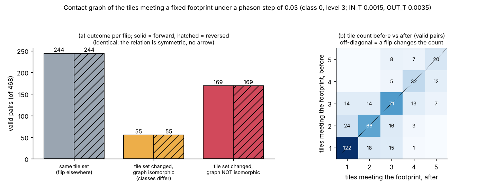
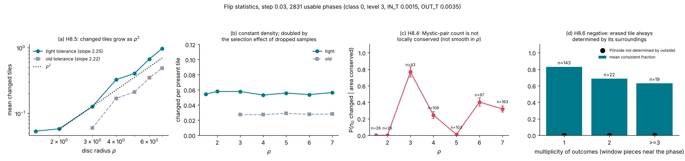
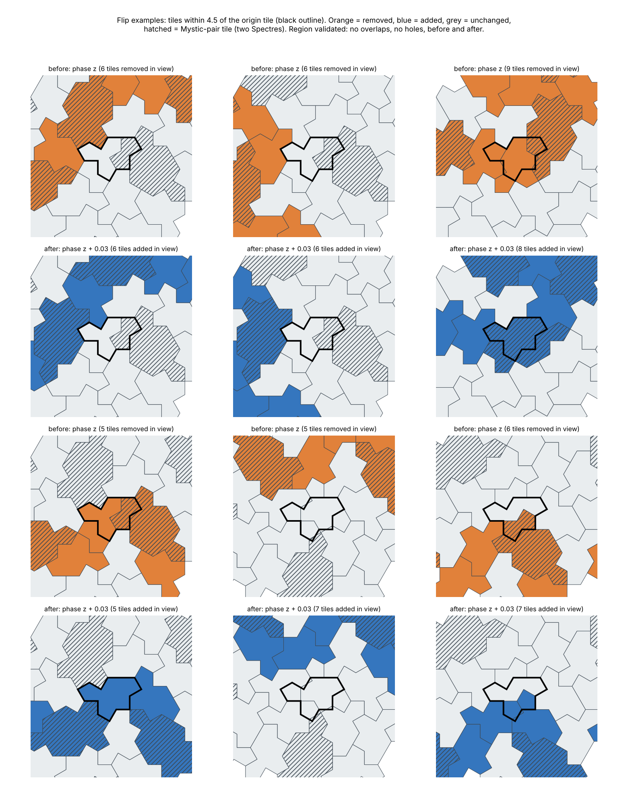

# toymodel_v8: figures of the corrected rerun

All figures are class 0, level 3, step 0.03, drawn by `plot_rerun.py` from the `*_tight_*` JSON files (tolerance IN_T 0.0015, OUT_T 0.0035, placement box PBOX 20). Numbers are **Counted** on one class and one footprint. They appear in `quantgrav.tex`, Section "Phason flips" (`sec:flips`).

Why a rerun: the first runs had a placement box of 12 that dropped Mystic-pair tiles (`STAGE1.md`) and a tolerance that made the old and the new tile both "present" exactly at flips (`STAGE3.md`). Everything here uses the corrected engine.

## 1. Contact graph under a phason step — `figures/fig_rerun_contact.png`



- (a) 468 valid pairs: 244 with the same tile set meeting the footprint, 55 with a changed tile set but an isomorphic graph, 169 with a changed tile set and a **non-isomorphic** graph. Hatched bars are the reversed step: identical, so the relation is symmetric and gives no arrow (`STAGE0.md`).
- (b) Fractions: tile set changed 0.48 of valid pairs (0.53 with the old settings, n = 60); not isomorphic 0.75 of the changed (0.84, n = 60).
- (c) Number of tiles meeting the footprint before against after: 157 of the 224 changed cases are off the diagonal.
- Reading: the contact graph changes in three quarters of the flips that touch the footprint, while the tetrad flux of the lift is zero for every flip. Not a reconnection in the sense of Comisso and Asenjo: no field, no non-ideal term, no helicity.

## 2. Flip statistics — `figures/fig_rerun_stats.png`



- (a) Changed tiles in a disc against its radius: slope 2.25 (2.22 with the old tolerance), so the density of change is uniform and positive (H8.5, supported).
- (b) Changed per present tile is constant, 0.056 (0.028 with the old tolerance, where more samples were dropped).
- (c) Among area-conserving events the Mystic-pair count changes in 0.32 of 163 events at rho = 7; not smooth in rho, only the sign is stable (H8.4).
- (d) Erasure of one tile: the probability that the inside is not determined by the outside is 0 for every multiplicity (H8.6, negative).

## 3. Examples of flips — `figures/fig_flip_gallery.png`



Six events picked at random from 416 validated ones that touch the footprint. Black outline: origin tile. Orange: present before, not after. Blue: present after, not before. Hatched: Mystic-pair tile. Each flip moves five to ten tiles in view; the clusters inspected have 8 to 17 tiles per side, so a flip is not a one-tile swap. No cluster closed inside the validated region (needs radius about 26), so no (dV, dE, dF) and no statement about Pachner-type moves.

## Reproduce

```
python3 export_flip_examples.py   # needs /tmp/PL_c0_r14_p20.pkl and /tmp/flip_states.npz from spectre_flip_moves.py
python3 plot_rerun.py             # writes fig_rerun_contact.png, fig_rerun_stats.png, fig_flip_gallery.png
```
Engines (run from `wada-coudene`, `SPECTRE_DIR` set): `IN_T=0.0015 OUT_T=0.0035 NS=6000 python3 figures/spectre_flip_contacts.py 3 0`; `... R2=7 NSA=3500 python3 figures/spectre_flip_stats.py 3 0`; `... NS=6000 R2=14 DIAM=5.5 python3 figures/spectre_flip_moves.py 3 0`. The box is `PBOX` (default 20).
